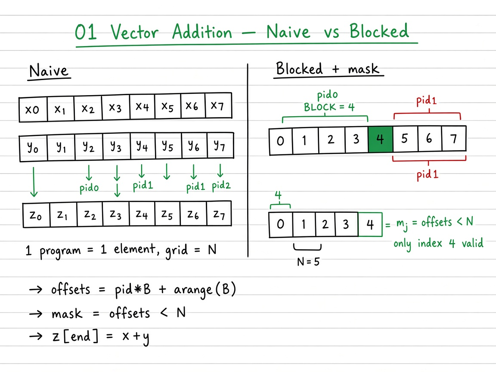
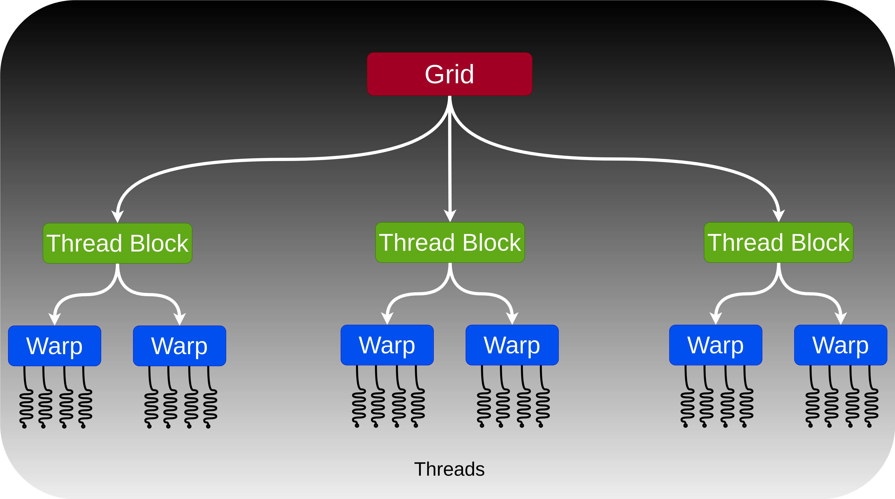
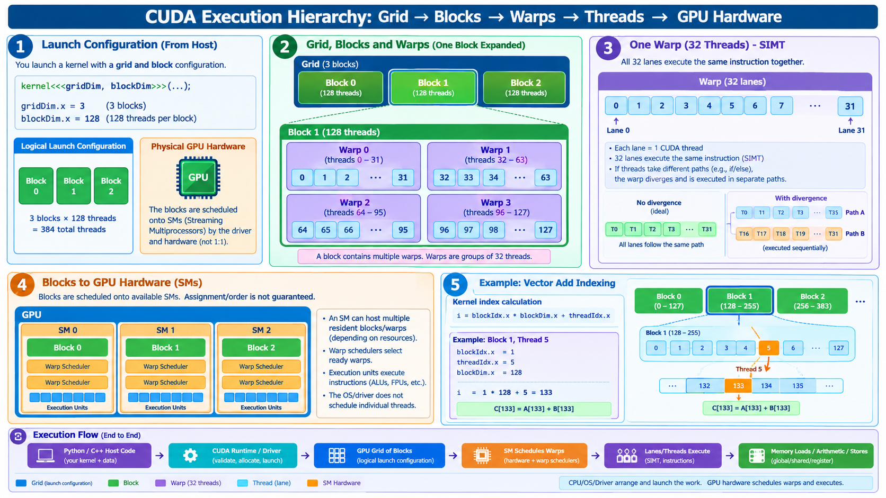
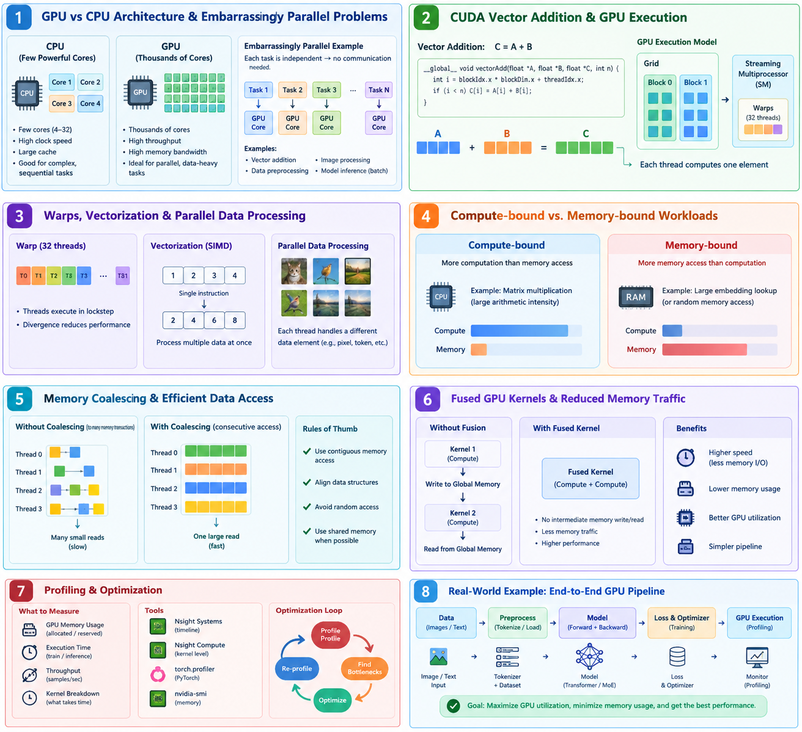

# 01 — Vector Addition

> **Goal.** Implement $z = x + y$ as a Triton GPU kernel, understand the SPMD launch model (programs ≈ CUDA blocks), and measure bandwidth against PyTorch.

Official reference: [Vector Addition](https://triton-lang.org/main/getting-started/tutorials/01-vector-add.html)

**Study ladder (from the notes / visuals):**

1. **Naive** — one program per index $i$ (grid size $N$)
2. **Blocked + masked** — one program per contiguous tile of size $B$; mask the remainder
3. **Triton** — same blocked algebra with `tl.program_id` / `tl.load` / `tl.store`

---

## Mathematical definition

Given two vectors $x, y \in \mathbb{R}^{N}$,

$$
z_i = x_i + y_i, \qquad i = 0,1,\ldots,N-1.
$$

In matrix form this is the elementwise (Hadamard) sum $z = x + y$. Arithmetic intensity is tiny: **one FLOP per three memory accesses** (read $x$, read $y$, write $z$), so the kernel is **memory-bound**.

**Running example (remainder / masking):** $N=5$, $B=4$ → $P=\lceil 5/4\rceil=2$ programs.

| pid | offsets (pre-mask) | mask | writes |
|-----|--------------------|------|--------|
| 0 | $\{0,1,2,3\}$ | all true | $z[0:4]$ |
| 1 | $\{4,5,6,7\}$ | only index 4 | $z[4]$ |

**Teaching sizes:** start with $N=1000$, $B\in\{128,256,1024\}$; official bench sweeps $N=2^{12}\ldots 2^{27}$.

### Bandwidth model

If each element is $b$ bytes (e.g. $b=4$ for `float32`), total traffic is

$$
T = 3\,N\,b \quad\text{(bytes)}.
$$

With runtime $t$ seconds, achieved bandwidth is

$$
\text{GB/s} = \frac{T}{t\cdot 10^{9}} = \frac{3\,N\,b}{t\cdot 10^{9}}.
$$

---

## Visual: theory board



*Theory board — naive grid size $N$ vs blocked tiles with `mask = offsets < N` (same algebra as the Triton kernel).*

## Visual: CUDA / Triton launch hierarchy





Triton **programs** sit at the block level of this hierarchy. Vector-add launches a **1-D grid** of programs; each program owns either one element (naive) or one contiguous tile of length $B$ (blocked).



*Primer: CPU vs GPU, warps, coalescing, fusion, memory-bound vs compute-bound (vector-add is memory-bound).*

---

## Visual: SPMD block tiling

```
 Global vector of length N
 |--------|--------|--------|--------|----|
   block0   block1   block2   block3  rem

 Program pid=0 loads offsets [0, B)
 Program pid=1 loads offsets [B, 2B)
 ...
 Program pid = ⌈N/B⌉−1 loads the last (possibly partial) tile
```

Each Triton **program** owns a contiguous tile of size $B = \texttt{BLOCK\_SIZE}$:

$$
\text{offsets}(\texttt{pid}) = \texttt{pid}\cdot B + \{0,1,\ldots,B-1\}.
$$

A **mask** $m_j = (\texttt{offsets}_j < N)$ guards the last incomplete tile so out-of-bounds loads/stores never happen.

Grid size:

$$
\text{grid} = \left\lceil \frac{N}{B} \right\rceil.
$$

---

## Self-check (study)

1. For $N=1000$, $B=256$, what is the grid size? Which pid has a partial mask?
2. Why is naive “1 pid per element” correct but a bad GPU schedule?
3. Write the Triton triad: `program_id` → `offsets` → `mask` → load / add / store.

---

## Common pitfalls

- Forgetting the mask on the last tile (OOB reads / NaNs).
- Choosing $B$ that is not a power of two (works often, but Triton shapes prefer powers of two).
- Benchmarking tiny $N$ and expecting peak GB/s.

---

## Kernel sketch (math ↔ code)

| Math | Triton |
|------|--------|
| $\texttt{pid}$ | `tl.program_id(0)` |
| $\texttt{offsets}$ | `pid * B + tl.arange(0, B)` |
| $x[\texttt{offsets}]$ | `tl.load(x_ptr + offsets, mask=...)` |
| $z = x+y$ | `tl.store(..., x + y, mask=...)` |

---

## What you will learn

1. `@triton.jit` and `BLOCK_SIZE: tl.constexpr`
2. Masked DRAM loads/stores
3. Correctness vs `torch.add`
4. Plotting GB/s with `triton.testing`

---

## Folder layout

| Path | Role |
|------|------|
| [`docs/README.md`](docs/README.md) | Memory model, masking lemmas, exercises |
| [`docs/visual-guide.md`](docs/visual-guide.md) | Mermaid + image walkthrough of the ladder |
| [`docs/images/`](docs/images/) | Benchmark PNG + CUDA hierarchy figures |
| [`01_vector_addition.ipynb`](01_vector_addition.ipynb) | Full interactive tutorial |
| [`tutorial.py`](tutorial.py) | Same kernel as a plain script |

```bash
cd 01_vector_addition
jupyter notebook 01_vector_addition.ipynb
# or
python tutorial.py
```
