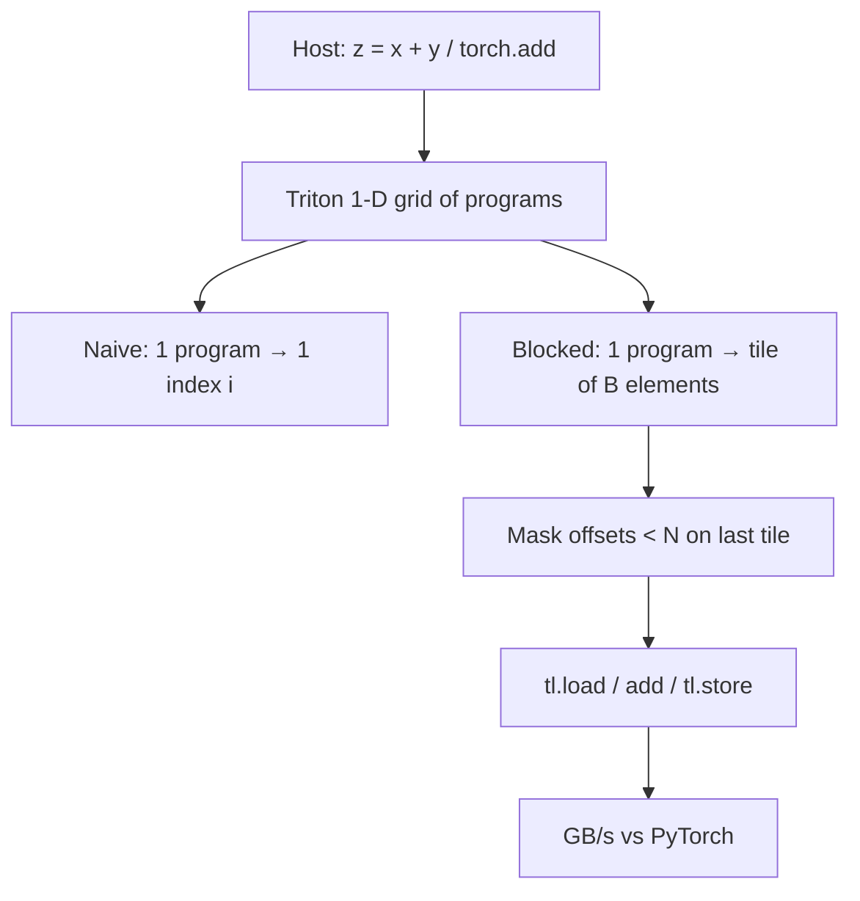
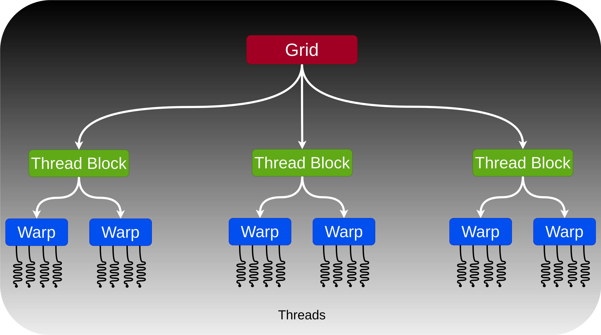
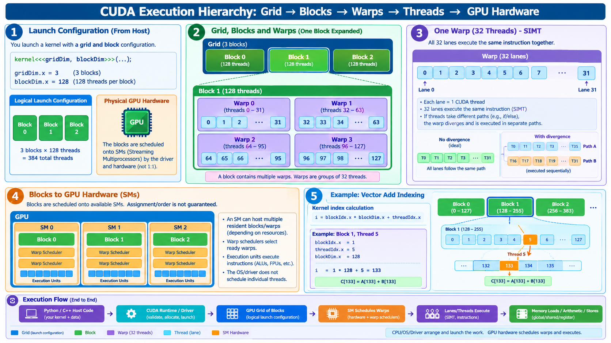
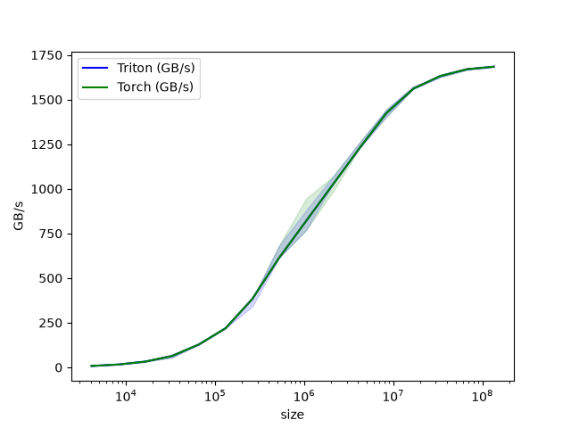
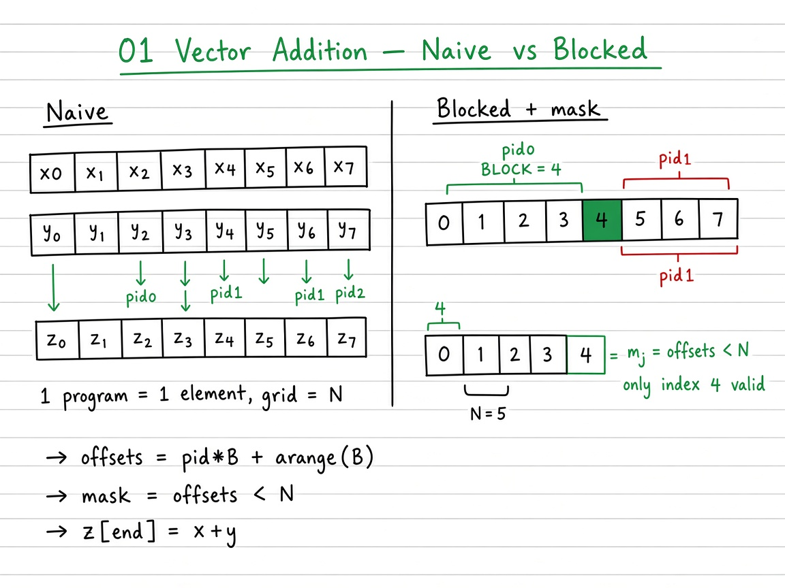

# Visual guide — Vector Addition

This note complements the [official Triton tutorial](https://triton-lang.org/main/getting-started/tutorials/01-vector-add.html).

## Goal

Learn vector add as a ladder: naive one-index programs → blocked + masked tiles → Triton `tl` kernel — then interpret the official GB/s benchmark.

## Mental model

## Figures in this folder

| Figure | What it shows |
|--------|----------------|
|  | Compact Grid / Block / Warp / Thread tree |
|  | Grid → blocks → warps (32) → lanes; SIMT |
|  | Official throughput vs problem size |

## Visual: theory board (method / logic)
## Theory board

*Theory board — naive grid size $N$ vs blocked tiles with `mask = offsets < N` (same algebra as the Triton kernel).*

*Theory board — naive grid size $N$ vs blocked tiles with `mask = offsets < N` (same algebra as the Triton kernel).*

Triton and PyTorch both sit near the memory-bandwidth ceiling for this op — fusion and tiling matter more on kernels with reuse (later tutorials).

## Step-by-step (what each phase does)

1. **Naive** — Flat pid over \(N\); \(z_i = x_i + y_i\). Correct but grid size \(N\) is huge for tiny work per program.
2. **Blocked + masked** — Program \(p\) owns offsets \(pB + \{0,\ldots,B-1\}\); mask \(offsets < N\). Teaching case: \(N=5\), \(B=4\) → 2 programs, one partial tile.
3. **Triton** — `pid = tl.program_id(0)`, `offsets = pid*B + tl.arange(0,B)`, masked `tl.load` / `tl.store`. Default \(B=1024\); grid `cdiv(N, B)`.
4. **Correctness** — `torch.allclose` vs `torch.add`; include sizes not divisible by \(B\) (e.g. 98432).
5. **Benchmark** — `triton.testing.perf_report` over \(N=2^{12}\ldots 2^{27}\); report GB/s \(= 3Nb/(t\cdot 10^9)\).

## Tips

- Start from the teaching remainder \(N=5\), \(B=4\) before jumping to \(2^{20}+\).
- Powers-of-two \(B\) map cleanly to Triton shapes; change \(B\in\{256,1024,4096\}\) and re-bench.
- If GB/s flatlines near peak DRAM, the kernel is doing its job — vector add is memory-bound.

## See also

- [Tutorials index](https://triton-lang.org/main/getting-started/tutorials/index.html)
- Deep dive: [`README.md`](README.md)
- Repo notebook: `01_vector_addition.ipynb`
