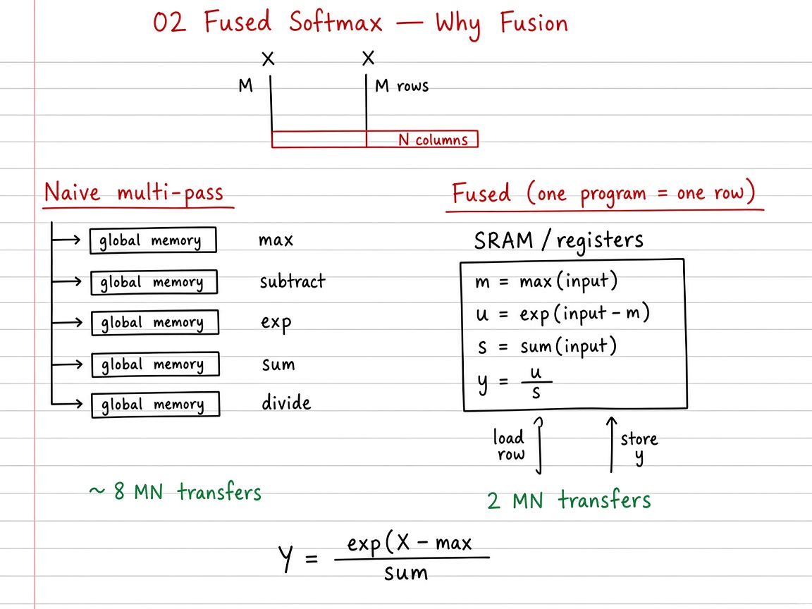

# 02 — Fused Softmax

> **Goal.** Compute row-wise softmax in **one** GPU kernel so each row of $X$ is read/written roughly once — far less DRAM traffic than a naive multi-pass PyTorch chain.

Official reference: [Fused Softmax](https://triton-lang.org/main/getting-started/tutorials/02-fused-softmax.html)

**Study ladder (from the notes / visuals):**

1. **Naive multi-pass** — separate max / sub / exp / sum / div tensor ops (many HBM trips)
2. **Per-row fuse** — one program owns a row; intermediates stay on-chip
3. **Triton** — persistent programs stride over rows; power-of-two `BLOCK_SIZE` + $-\infty$ padding

---

## Mathematical definition

For a matrix $X \in \mathbb{R}^{M \times N}$, the **row-wise** (numerically stable) softmax is: for each row $i$,

$$
m_i = \max_{j} X_{ij}, \qquad
\tilde{X}_{ij} = X_{ij} - m_i, \qquad
Y_{ij} = \frac{e^{\tilde{X}_{ij}}}{\sum_{k=1}^{N} e^{\tilde{X}_{ik}}}.
$$

Equivalently,

$$
Y_{ij} = \operatorname{softmax}(X_{i,:})_j
= \frac{\exp(X_{ij} - \max_k X_{ik})}{\sum_k \exp(X_{ik} - \max_\ell X_{i\ell})}.
$$

Softmax is **shift-invariant**: $\operatorname{softmax}(x + c) = \operatorname{softmax}(x)$ for any scalar $c$ — that is why subtracting $m_i$ is valid and prevents overflow.

**Running example (power-of-two pad):** $N=5$ → $B = \operatorname{next\_power\_of\_2}(5)=8$; lanes $j\ge 5$ load $-\infty$ so they do not affect $\max$ / $\exp$.

**Teaching sizes:** pseudo tests use $M\times N = 32\times 64$; GPU correctness often uses odd widths; official bench fixes $M=4096$ and sweeps $N = 128,256,\ldots$.

---

## Visual: theory board



*Theory board — five HBM passes (~$8MNb$) vs fused row softmax (~$2MNb$ traffic).*

## Why fusion? (memory traffic)

A naive sequence of PyTorch ops on $X \in \mathbb{R}^{M\times N}$ roughly does:

| Step | Reads | Writes |
|------|-------|--------|
| row max | $MN$ | $M$ |
| subtract max | $MN+M$ | $MN$ |
| exp | $MN$ | $MN$ |
| row sum | $MN$ | $M$ |
| divide | $MN+M$ | $MN$ |

**Order of magnitude:** $\sim 5MN$ reads and $\sim 3MN$ writes.

A **fused** kernel that keeps the row in SRAM / registers only needs:

$$
\sim MN \text{ reads} + MN \text{ writes} = 2MN \text{ transfers}.
$$

Theoretical speedup vs naive (ignoring constants):

$$
\frac{(5+3)MN}{2MN} \approx 4\times
$$

when the kernel is bandwidth-bound and the row fits on-chip.

---

## Visual: one program = many rows (persistent)

```
          columns →
        ┌───────────────────┐
 row 0  │■■■■■■■■■■■■■■■■■■■│  ← program 0
 row 1  │□□□□□□□□□□□□□□□□□□□│  ← program 1
 row 2  │■■■■■■■■■■■■■■■■■■■│  ← program 0 (next row)
 ...    │                   │
        └───────────────────┘

 Programs stride by num_programs (persistent loop over rows).
```

Block size:

$$
B = 2^{\lceil \log_2 N \rceil} = \operatorname{next\_power\_of\_2}(N),
$$

with mask $j < N$ and invalid lanes loaded as $-\infty$ so they do not affect $\max$ / $\exp$.

---

## Self-check (study)

1. Why subtract $\max_j X_{rj}$ before $\exp$? (Name the invariance.)
2. Rough HBM traffic: naive multi-pass vs fused (order of $MN$ transfers).
3. What does a **persistent** row loop (`pid`, `pid+P`, …) buy you?

---

## Common pitfalls

- Softmax over the wrong dim (columns vs rows).
- Loading padded lanes as `0` instead of $-\infty$ when taking `max` / `exp`.
- Expecting fusion wins when $N$ is tiny (kernel launch dominates).

---

## Reduction operators in Triton

$$
m = \operatorname{tl.max}(\text{row}), \quad
s = \operatorname{tl.sum}(e^{\text{row}-m}), \quad
y = e^{\text{row}-m}/s.
$$

---

## Folder layout

| Path | Role |
|------|------|
| [`docs/README.md`](docs/README.md) | Traffic math, occupancy, exercises |
| [`docs/visual-guide.md`](docs/visual-guide.md) | Mermaid + image walkthrough of the ladder |
| [`docs/images/`](docs/images/) | Whiteboard theory figures |
| [`02_fused_softmax.ipynb`](02_fused_softmax.ipynb) | Full interactive tutorial |
| [`tutorial.py`](tutorial.py) | Runnable script |

```bash
cd 02_fused_softmax
jupyter notebook 02_fused_softmax.ipynb
# or
python tutorial.py
```
