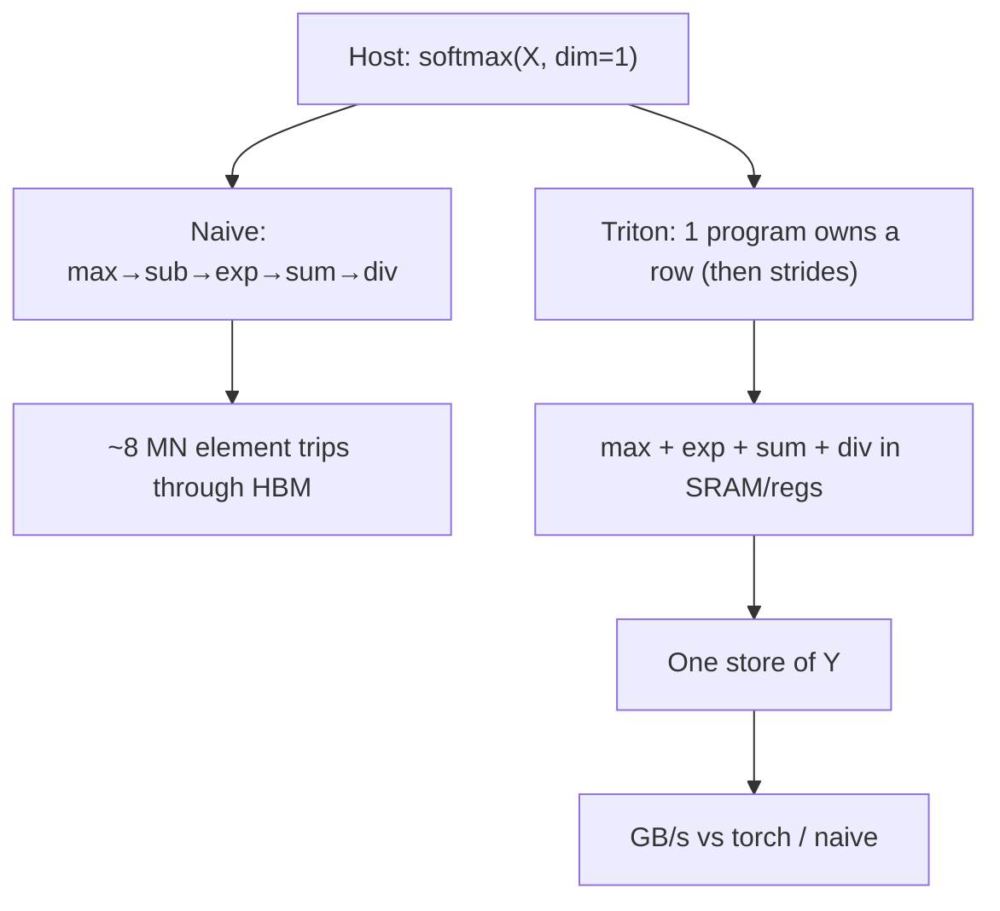
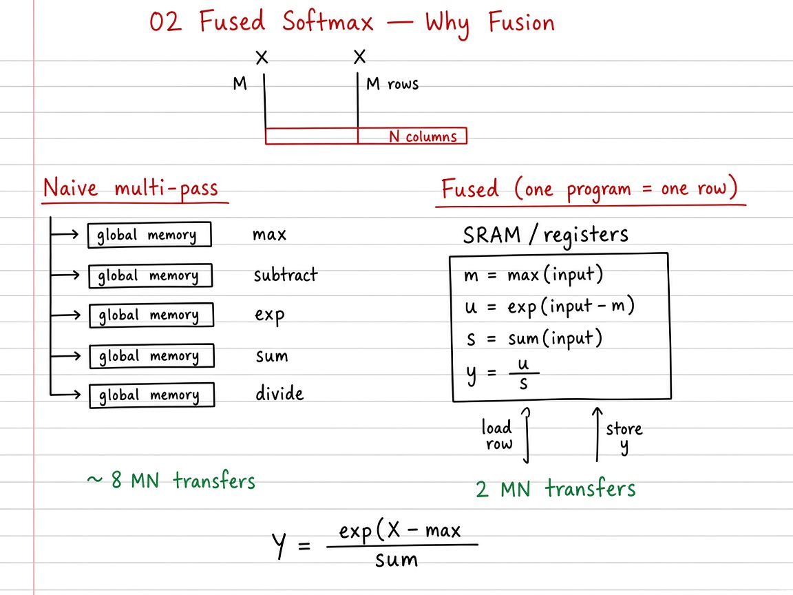

# Visual guide — Fused Softmax

This note complements the [official Triton tutorial](https://triton-lang.org/main/getting-started/tutorials/02-fused-softmax.html).

## Goal

Learn row-wise softmax as a ladder: naive multi-pass HBM traffic → per-row fuse → persistent Triton kernel — then read the official GB/s vs \(N\) figure.

## Mental model

## Figures in this folder

| Figure | What it shows |
|--------|----------------|
|  | Softmax GB/s vs columns (\(M=4096\)) |

## Visual: theory board (method / logic)
## Theory board

*Theory board — five HBM passes (~$8MNb$) vs fused row softmax (~$2MNb$ traffic).*

*Theory board — five HBM passes (~$8MNb$) vs fused row softmax (~$2MNb$ traffic).*

Fused Triton cuts DRAM traffic toward \(2MNb\) bytes; naive multi-pass pays several full-matrix passes.

## Step-by-step (what each phase does)

1. **Naive multi-pass** — Five sequential tensor ops; traffic \(\sim (8MN+4M)b\). Correct numerically (with max-shift) but bandwidth-heavy.
2. **Per-row fuse** — For each row \(r\): \(m_r=\max_j X_{rj}\), \(U=\exp(X-m)\), \(s=\sum U\), \(Y=U/s\). Same math; intermediates need not be global tensors.
3. **Triton** — `BLOCK_SIZE = next_power_of_2(N)`; pad with \(-\infty\); programs loop `row = pid; row < M; row += num_programs`.
4. **Correctness** — `allclose` vs `torch.softmax(..., dim=1)` on shapes like \(32\times 64\) and odd \(N\).
5. **Benchmark** — Fix \(M=4096\), sweep \(N\); report GB/s \(\approx 2MNb/(t\cdot 10^9)\).

## Tips

- Start from a tiny width (\(N=5\to B=8\)) to see \(-\infty\) padding before jumping to \(N=4096+\).
- Softmax is **shift-invariant** — subtracting the row max is free numerically and required for stability.
- Occupancy: register/shared use of the fused row limits how many programs fit per SM; `num_programs ≈ #SM × occupancy`, capped by \(M\).
- Re-run `python scripts/download_tutorial_images.py` if figures are missing offline.

## See also

- [Tutorials index](https://triton-lang.org/main/getting-started/tutorials/index.html)
- Deep dive: [`README.md`](README.md)
- Repo notebook: `02_fused_softmax.ipynb`
