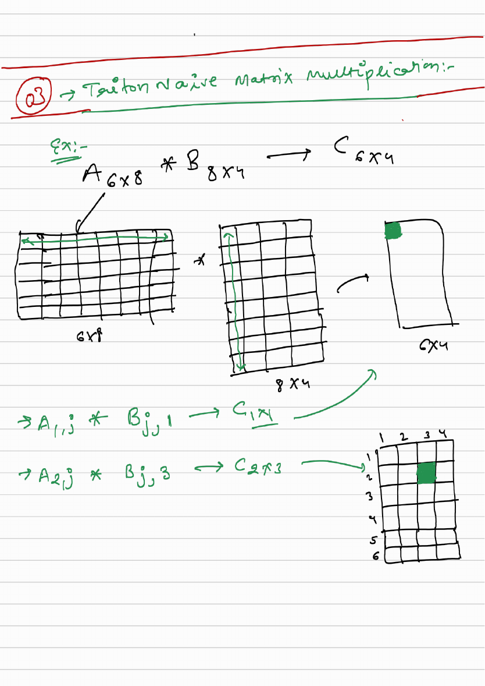
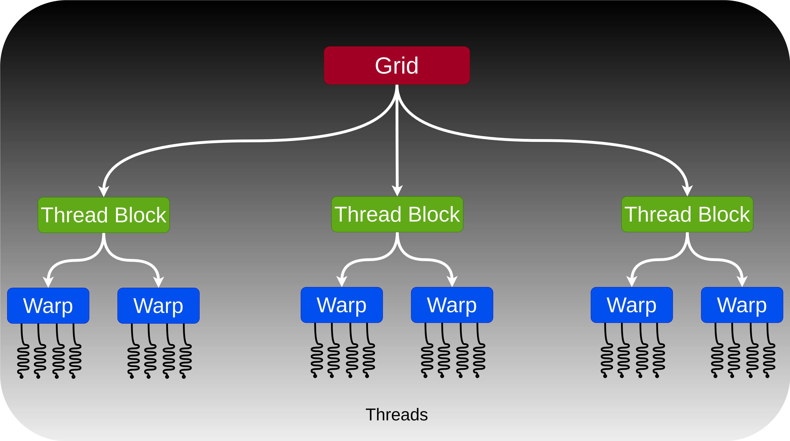
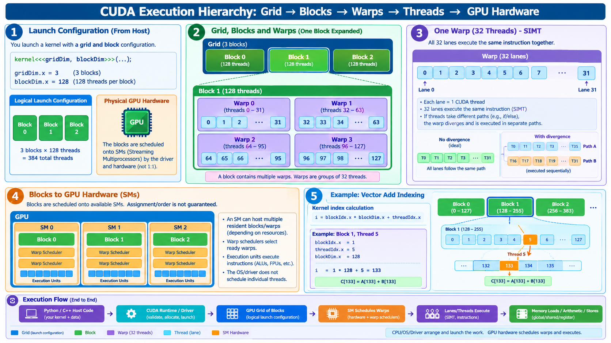
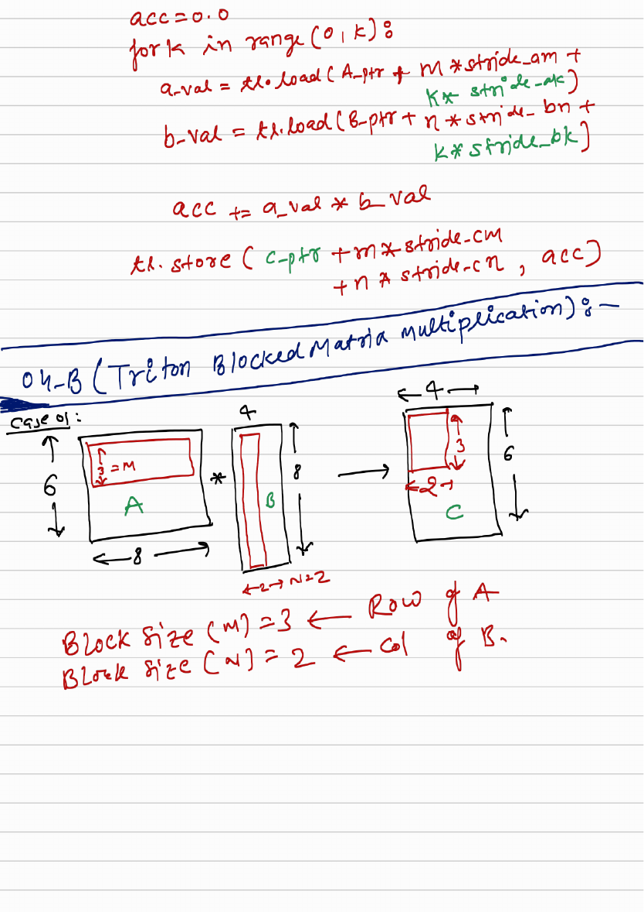
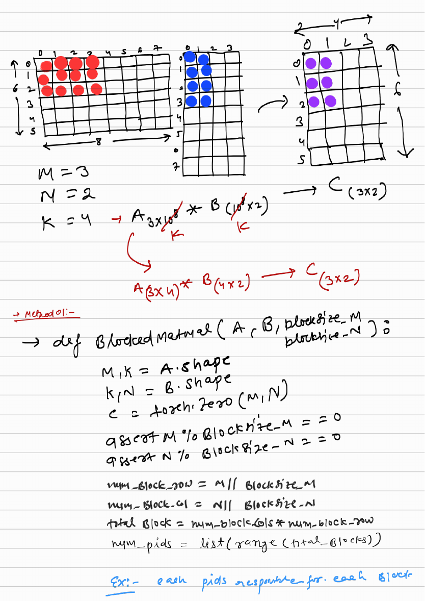
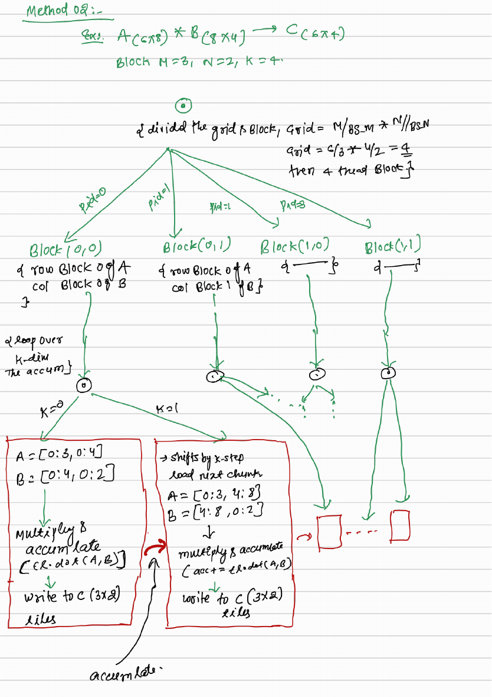
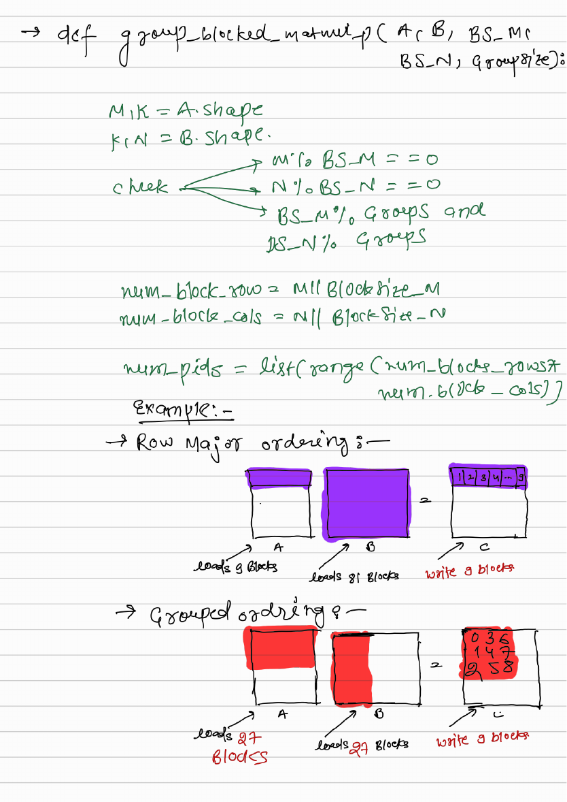
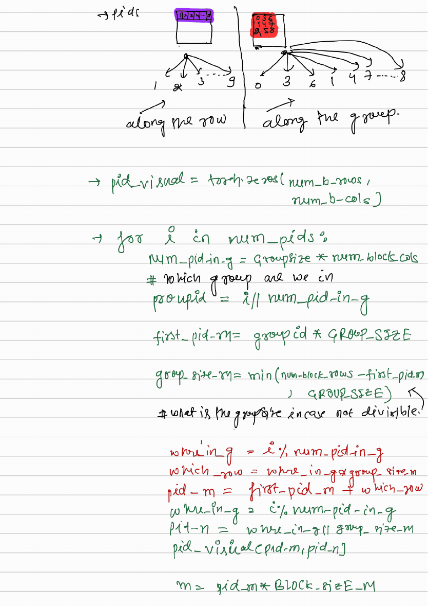

# 03 — Matrix Multiplication (GEMM)

> **Goal.** Compute $C = AB$ with a blocked Triton kernel, multi-dimensional pointer arithmetic, L2-friendly program ordering, and optional autotuning — competitive with vendor BLAS for FP16.

Official reference: [Matrix Multiplication](https://triton-lang.org/main/getting-started/tutorials/03-matrix-multiplication.html)

**Study ladder (from the notes / visuals):**

1. **Naive** — one program per $C_{mn}$
2. **Blocked** — one program per $B_M\times B_N$ tile of $C$
3. **K-tiling** — stream the reduction in chunks of $B_K$
4. **Grouped** — swizzle program IDs for L2 reuse
5. **Triton** — same algebra as SPMD kernels

---

## Mathematical definition

$$
A \in \mathbb{R}^{M\times K},\quad
B \in \mathbb{R}^{K\times N},\quad
C = AB \in \mathbb{R}^{M\times N},
$$

$$
C_{mn} = \sum_{k=0}^{K-1} A_{mk}\, B_{kn}
= \langle A_{m,:},\, B_{:,n}\rangle.
$$

**Running example (naive / early blocked):** $A_{6\times 3}\, B_{3\times 8} \to C_{6\times 8}$.

**Running example (K-tiled):** $A_{6\times 8}\, B_{8\times 4} \to C_{6\times 4}$ with
$B_M=3$, $B_N=2$, $B_K=4$.

FLOP count (multiply–add as 2 FLOPs): $\text{FLOPs} = 2MNK$.
TFLOPS from runtime $t$: $\text{TFLOPS} = 2MNK / (t\cdot 10^{12})$.

---

## Visual: naive — one thread / program per output

![Naive matmul: one thread per C[m,n], host → GPU warps.](docs/images/matmul-naive-threads.png)

*From code to GPU threads: each $C[m,n]$ is owned by one program; $m = i // N$, $n = i \% N$.*



Flat program id $\mathrm{pid}\in\{0,\ldots,MN-1\}$:

$$
m = \left\lfloor\frac{\mathrm{pid}}{N}\right\rfloor,\qquad
n = \mathrm{pid}\bmod N,\qquad
C_{mn}=\sum_{k} A_{mk}B_{kn}.
$$

Example: $M=6$, $N=8$ → 48 programs; pid $19$ writes $C[2,3]$.

Row access $A[m,:]$ is contiguous; column access $B[:,n]$ is strided — this is why tiling / cache order matter later.

---

## Visual: CUDA / Triton launch hierarchy





Triton **programs** sit at the block level of this hierarchy. A matmul launch is a 1-D grid of programs; each program owns either one element (naive) or one $C$-tile (blocked / grouped).

---

## Blocked algorithm

Tile $C$ into blocks of size $B_M\times B_N$. One program owns one tile. For each tile, stream $K$ in chunks of $B_K$:

$$
\begin{aligned}
\text{Acc} &\leftarrow 0_{B_M\times B_N} \\
\text{for }\; &t = 0,\ldots,\lceil K/B_K\rceil-1: \\
&\quad A_t \leftarrow A[m:m+B_M,\; tB_K:(t+1)B_K] \\
&\quad B_t \leftarrow B[tB_K:(t+1)B_K,\; n:n+B_N] \\
&\quad \text{Acc} \mathrel{+}= A_t B_t \\
C[m:m+B_M,\; n:n+B_N] &\leftarrow \text{Acc}
\end{aligned}
$$







Teaching sizes from the notes:

| Stage | Shapes | Blocks | Programs |
|-------|--------|--------|----------|
| Blocked (full $K$) | $6\times 3 @ 3\times 8$ | $B_M=3$, $B_N=4$ | $2\times 2=4$ |
| K-tiled | $6\times 8 @ 8\times 4$ | $B_M=3$, $B_N=2$, $B_K=4$ | $2\times 2=4$, 2 K-steps |

Accumulator stays in **FP32** even when $A,B$ are FP16; cast when storing $C$.

---

## Pointer arithmetic

For row-major $X$, $\&X[i,j] = X + i\cdot\texttt{stride}_0 + j\cdot\texttt{stride}_1$.

$A$-tile pointers and $K$-advance:

$$
A_{\text{ptrs}} = a_{\text{ptr}}
 + o_m[:,\texttt{None}]\cdot s_{am}
 + o_k[\texttt{None},:]\cdot s_{ak},
\qquad
A_{\text{ptrs}} \mathrel{+}= B_K\cdot s_{ak}.
$$

Same idea for $B$ with $o_k$ / $o_n$.

---

## L2 cache: grouped program IDs

Row-major launch order reloads $A$/$B$ tiles too often. **Group** $G_M$ rows of tiles and walk them in **column-major** order inside the group — improves L2 hit rate (often $>10\%$ speedup).





Illustrative load counts from the notes (writing 9 $C$-tiles, `GROUP_SIZE=3`):

| Order | A-panel loads | B-panel loads |
|-------|---------------|---------------|
| Row-major | 9 | 81 |
| Grouped | 27 | 27 |

Only the $\mathrm{pid}\mapsto(p_m,p_n)$ map changes; the $K$-loop / `tl.dot` body is identical to the blocked kernel.

---

## Self-check (study)

1. Map flat $\mathrm{pid}$ to $(m,n)$ for naive GEMM; give one numeric example.
2. Why introduce $B_K$ when $K$ is huge?
3. Grouped ordering: what stays the same, and what changes, vs row-major tiles?
4. (Harder.) Sketch why grouping can cut $B$-panel reloads (L2 intuition).

---

## Common pitfalls

- Mixing up **grouped L2 swizzle (this folder)** with **Group GEMM (08)**.
- Accumulating the tile in FP16 (use FP32 `Acc`, cast on store).
- Wrong strides when $A$/$B$ are not contiguous row-major.

---

## Folder layout

| Path | Role |
|------|------|
| [`docs/README.md`](docs/README.md) | Grouped scheduling math, autotune, exercises |
| [`docs/visual-guide.md`](docs/visual-guide.md) | Image walkthrough of the ladder |
| [`docs/images/`](docs/images/) | Infographics + scanned note pages |
| [`docs/visual-guide.pdf`](docs/visual-guide.pdf) | Full handwritten visual guide |
| [`03_matrix_multiplication.ipynb`](03_matrix_multiplication.ipynb) | Full interactive tutorial |
| [`tutorial.py`](tutorial.py) | Autotuned kernel script |
| [`asserts/`](asserts/) | Source assets (PNG / PDF) |

```bash
cd 03_matrix_multiplication
jupyter notebook 03_matrix_multiplication.ipynb
```
