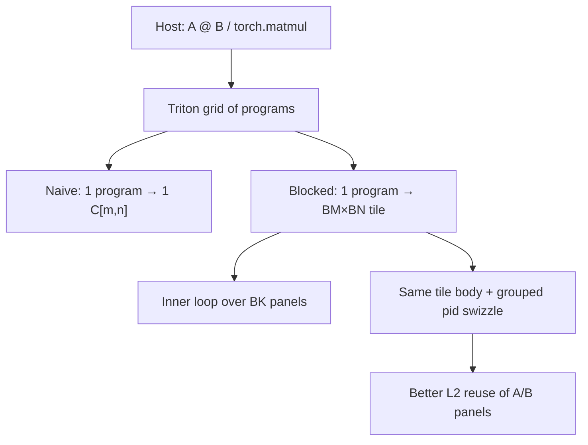
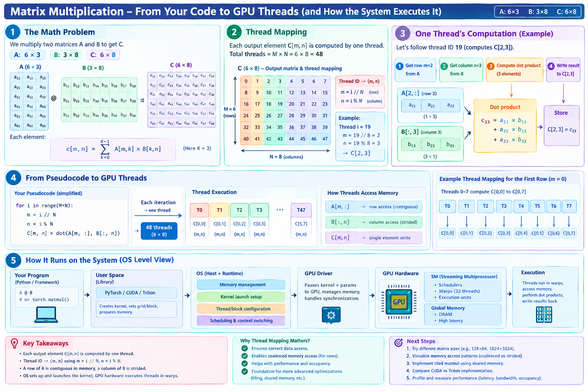
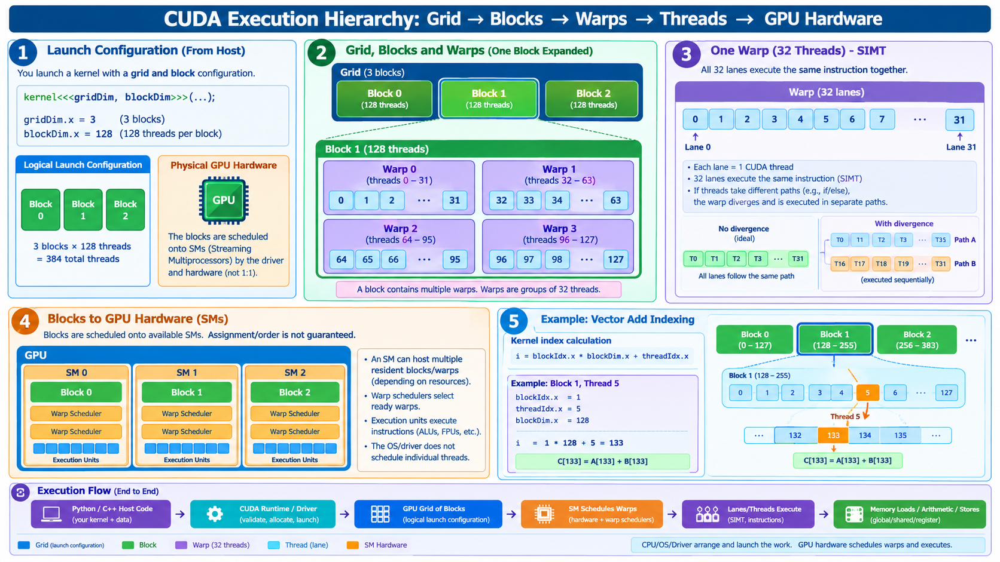
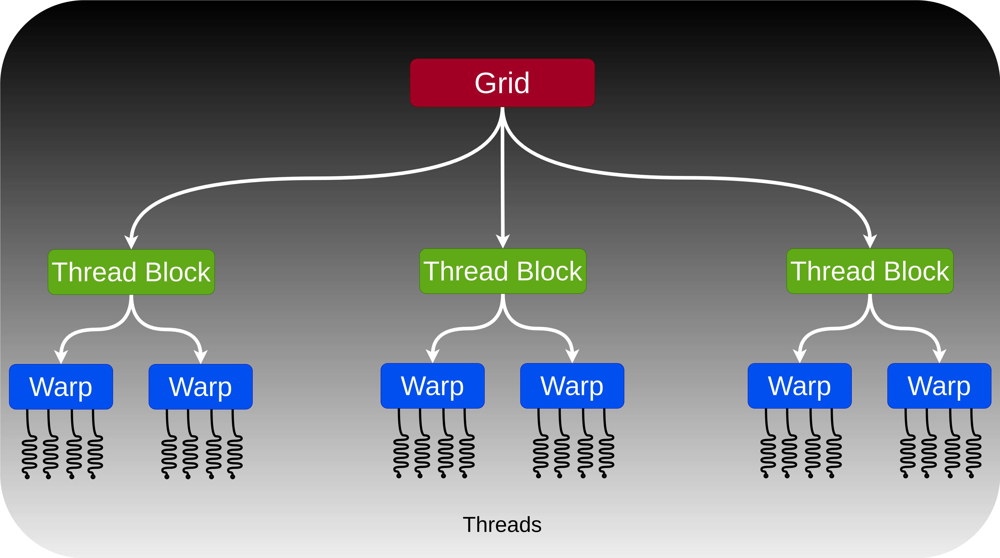
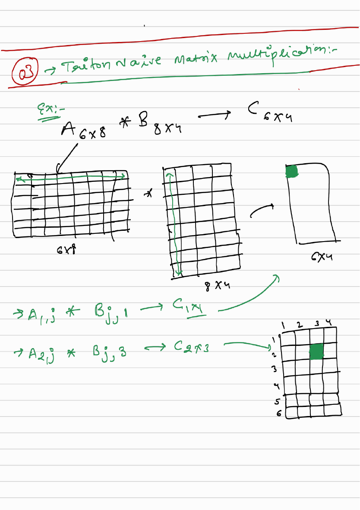
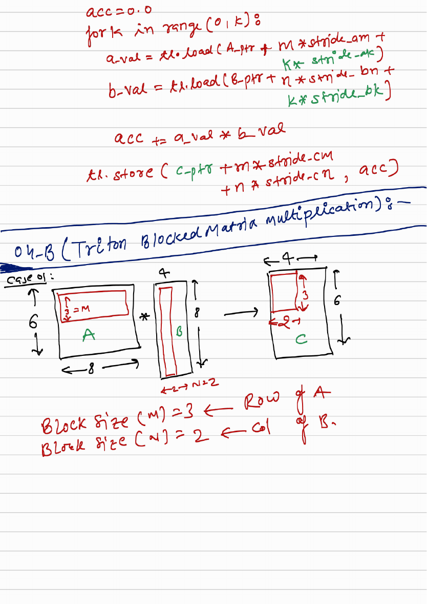
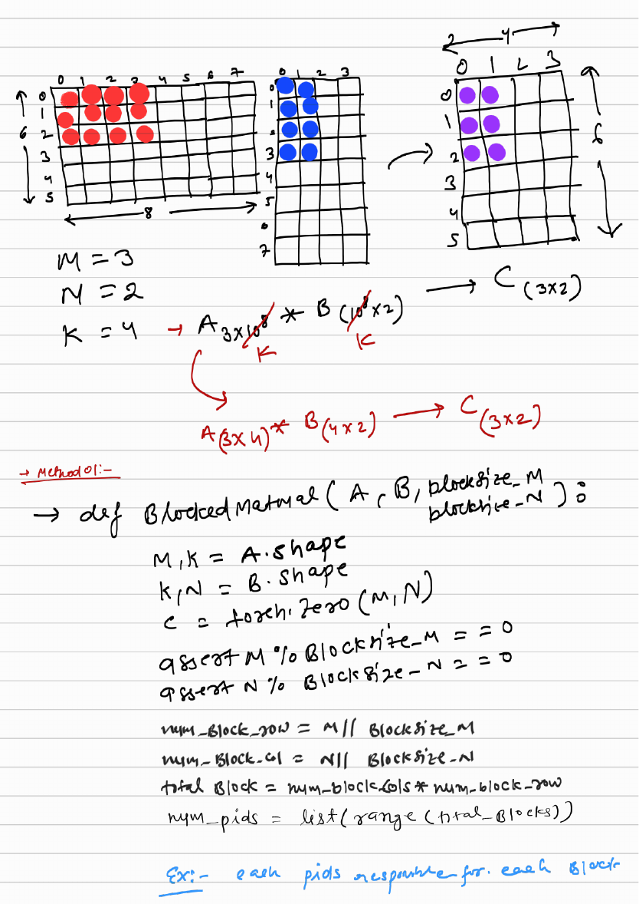
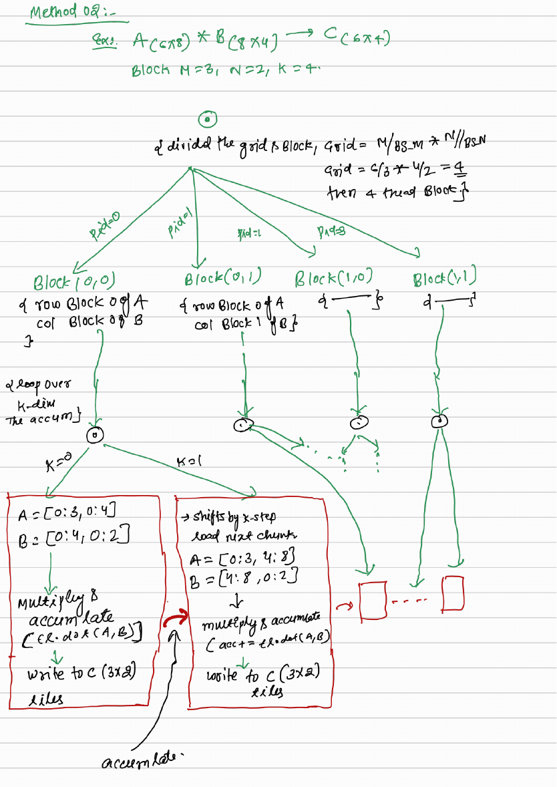
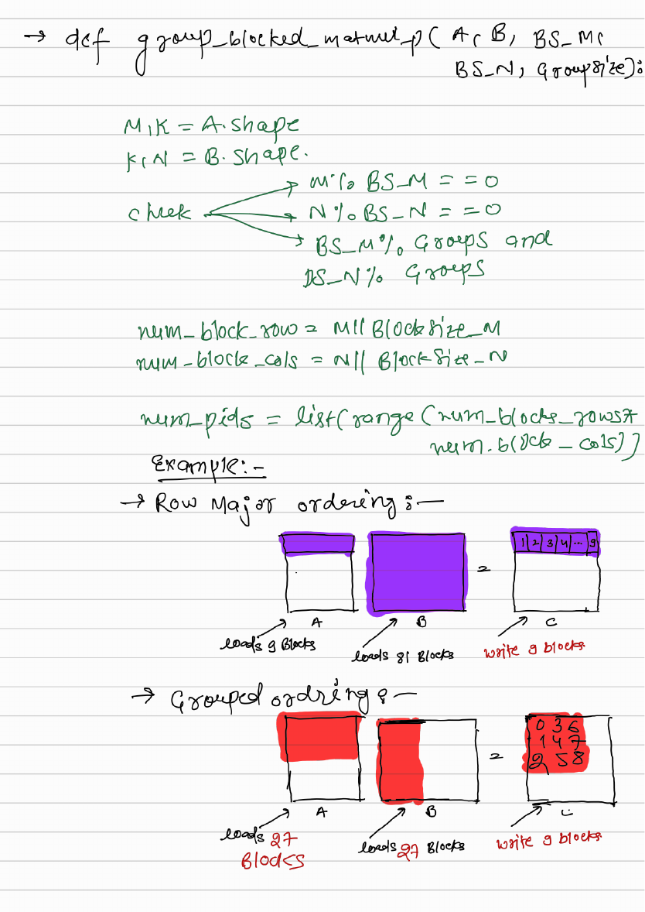
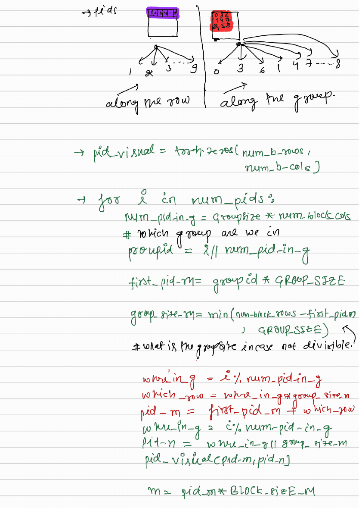

# Visual guide — Matrix Multiplication

This note complements the [official Triton tutorial](https://triton-lang.org/main/getting-started/tutorials/03-matrix-multiplication.html) and the handwritten pack in [`visual-guide.pdf`](visual-guide.pdf).

## Goal

Learn GEMM as a ladder: naive element programs → blocked tiles → \(K\)-tiling → L2-friendly grouped program order → Triton kernels.

## Mental model

## Figures in this folder

| Figure | What it shows |
|--------|----------------|
|  | One thread/program per \(C[m,n]\); \(m=i//N\), \(n=i\%N\); host→SM/warps |
|  | Grid → blocks → warps (32) → lanes; SIMT |
|  | Compact Grid / Block / Warp / Thread tree |
|  | Hand notes: \(A_{6\times 8}\,B_{8\times 4}\to C_{6\times 4}\) |
|  | \(B_M=3\), \(B_N=2\) output tile |
|  | \(A_{3\times 4}\,B_{4\times 2}\to C_{3\times 2}\) |
|  | Two \(B_K\) steps accumulating into one tile |
|  | Row-major vs grouped A/B load counts |
|  | Column-major pid order inside a group |

## Step-by-step (what each phase does)

1. **Naive** — Flat pid over \(M\times N\); correct but no tile reuse.
2. **Blocked** — Program owns a \(B_M\times B_N\) tile of \(C\); still may take full-\(K\) strips.
3. **K-tiling** — When \(K\) is large, accumulate `tl.dot` over panels of width \(B_K\) in FP32.
4. **Grouped** — Only change how pid maps to \((p_m,p_n)\); keep the same pointer/`dot`/store body.
5. **Benchmark** — Autotune `BLOCK_SIZE_{M,N,K}`, `GROUP_SIZE_M`, `num_warps`, `num_stages`; report TFLOPS vs cuBLAS.

## Tips

- Start from the teaching sizes in the notes (\(6\times 3@3\times 8\), then \(6\times 8@8\times 4\) with \(B_M,B_N,B_K=3,2,4\)) before jumping to \(512+\).
- Grouping does not change numerical \(C\); it only permutes which program writes which tile.
- Full scanned pack: [`visual-guide.pdf`](visual-guide.pdf) (same content as `asserts/02_matix.pdf`).

## See also

- [Tutorials index](https://triton-lang.org/main/getting-started/tutorials/index.html)
- Repo notebook: `03_matrix_multiplication.ipynb`
