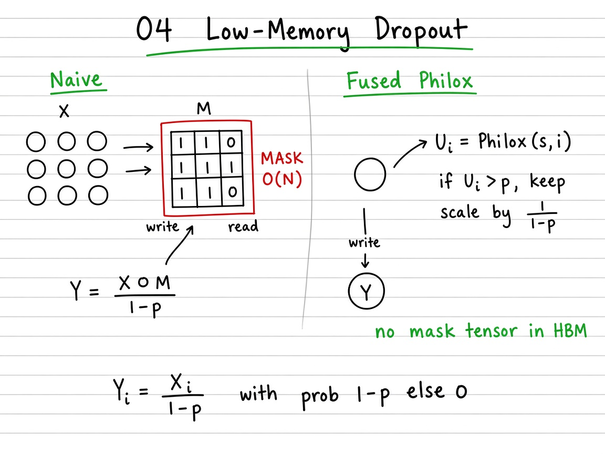

# 04 — Low-Memory Dropout

> **Goal.** Apply dropout using a **seed + Philox RNG inside the kernel**, so you never materialize a full boolean mask tensor in DRAM — same distribution as classic inverted dropout, $O(1)$ RNG state instead of $O(N)$ mask storage.

Official reference: [Low-Memory Dropout](https://triton-lang.org/main/getting-started/tutorials/04-low-memory-dropout.html)

**Study ladder (from the notes / visuals):**

1. **Naive** — sample $U$, materialize mask $M=\mathbf{1}[U>p]$, then scale $Y = (X\odot M)/(1-p)$
2. **Fused (Python)** — one pass: rand + keep/drop + invert scale; still host-side RNG
3. **Seeded Philox** — store only integer seed $s$; regenerate $U_i=\operatorname{Philox}(s,i)$ on demand
4. **Triton** — `tl.rand(seed, offsets)` in-kernel; mask lives in registers, never in DRAM

---

## Mathematical definition

Given input $x \in \mathbb{R}^{N}$ and dropout probability $p \in [0,1)$, training-time dropout with **inverted scaling** is:

$$
y_i =
\begin{cases}
\dfrac{x_i}{1-p} & \text{with probability } 1-p, \\[6pt]
0 & \text{with probability } p.
\end{cases}
$$

Equivalently, with Bernoulli masks $m_i \sim \operatorname{Bernoulli}(1-p)$,

$$
y_i = \frac{m_i}{1-p}\, x_i.
$$

At evaluation, $p=0$ and $y=x$. The factor $1/(1-p)$ keeps $\mathbb{E}[y_i]=x_i$.

**Teaching example.** $N=8$, $p=0.5$, seed $s=0$: eight Philox draws $u_0,\ldots,u_7$; keep indices where $u_i>0.5$ and scale those $x_i$ by $2$.

---

## Visual: theory board



*Theory board — $O(N)$ mask tensor in DRAM vs seed + `Philox(s,i)` keep/drop in registers.*

## Why “low memory”?

**Classic approach:** store mask $m \in \{0,1\}^N$ (or bit-packed) for the backward pass → extra $O(N)$ DRAM.

**Seeded approach:** store only an integer seed $s$. On any forward/backward, regenerate

$$
u_i = \operatorname{Philox}(s, i) \sim \mathcal{U}[0,1), \qquad
m_i = \mathbf{1}[u_i > p].
$$

Same seed ⇒ same mask. Memory for RNG state: $O(1)$ instead of $O(N)$.

---

## Visual: classic vs seeded


*Theory board — $O(N)$ mask tensor in DRAM vs seed + `Philox(s,i)` keep/drop in registers.*

```
 Classic:   x ──► kernel ──► y
            m ──► (full mask in DRAM)

 Seeded:    x ──► kernel ──► y
            s ──► (Philox per offset; no mask tensor)
```

| Stage | What lives in DRAM | RNG |
|-------|--------------------|-----|
| Naive | $x$, $m$, $y$ | host / separate kernel |
| Fused Python | $x$, $y$ (+ transient $u$) | host Philox / torch |
| Triton | $x$, $y$ only | `tl.rand` per lane |

---

## Self-check (study)

1. Show $\mathbb{E}[Y_i]=X_i$ for inverted dropout with keep-prob $1-p$.
2. What is stored instead of the $O(N)$ mask in the low-memory path?
3. Why must forward and backward share the **same seed**?

---

## Common pitfalls

- Using dropout probability $p$ vs keep-prob $q=1-p$ inconsistently in the scale.
- Materializing a mask “for debugging” and accidentally measuring that path’s bandwidth.
- Different seeds on forward vs backward → wrong gradients.

---

## Concrete teaching walk

Functions in this folder (names used by tests — do not rename):

| Function | Role |
|----------|------|
| `naive_dropout_pseudo` | Materialize mask, then scale |
| `fused_dropout_pseudo` | Single-pass rand + scale (Python) |
| `dropout_kernel` / `dropout` | Triton kernel + host launcher |

Expected value check (Monte Carlo): for fixed $x$, average many seeds of $y$ → $\approx x$ when $p$ is moderate and $N$ is large enough for the law of large numbers.

---

## Folder layout

| Path | Role |
|------|------|
| [`docs/README.md`](docs/README.md) | Philox intuition, expectation proof, exercises |
| [`docs/visual-guide.md`](docs/visual-guide.md) | Mermaid mental model + benchmark walkthrough |
| [`docs/images/`](docs/images/) | Whiteboard theory figures |
| [`04_low_memory_dropout.ipynb`](04_low_memory_dropout.ipynb) | Interactive ladder (naive → fused → Triton) |
| [`tutorial.py`](tutorial.py) | Kernel script + tests |

```bash
cd 04_low_memory_dropout
jupyter notebook 04_low_memory_dropout.ipynb
# or
python tutorial.py
```
