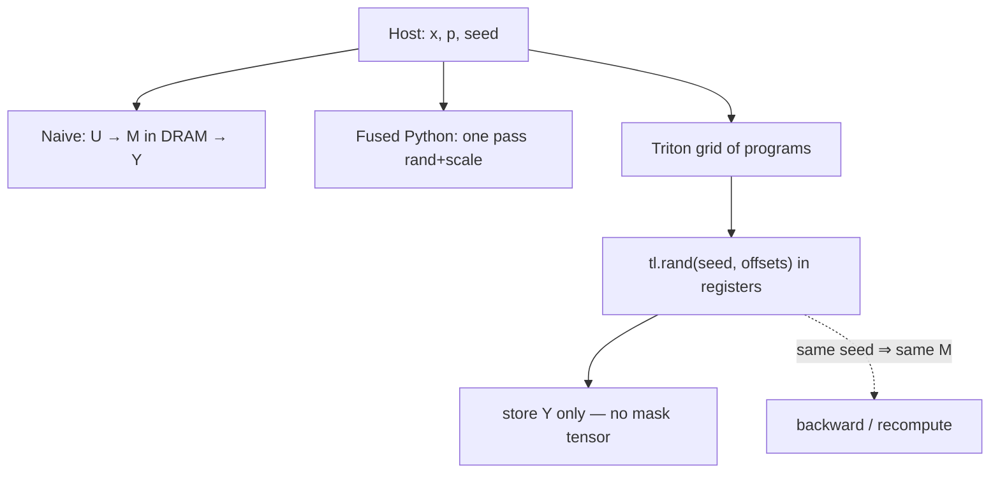
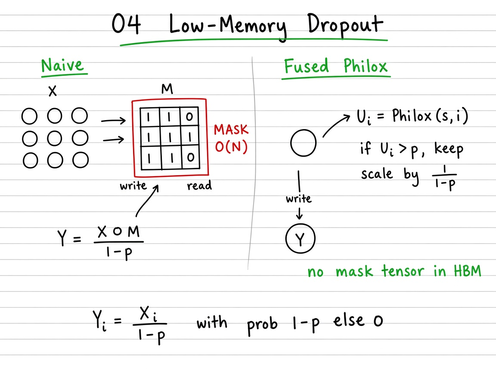

# Visual guide — Low-Memory Dropout

This note complements the [official Triton tutorial](https://triton-lang.org/main/getting-started/tutorials/04-low-memory-dropout.html).

## Goal

Learn dropout as a ladder: materialize a full mask → fuse rand+scale on the host → seed + Philox so the mask is never stored → Triton `tl.rand` in-kernel.

## Mental model

## Visual: theory board (method / logic)
## Theory board

*Theory board — $O(N)$ mask tensor in DRAM vs seed + `Philox(s,i)` keep/drop in registers.*

*Theory board — $O(N)$ mask tensor in DRAM vs seed + `Philox(s,i)` keep/drop in registers.*

## Step-by-step (what each phase does)

1. **Naive** — Draw \(U\sim\mathcal{U}[0,1)^N\), write \(M=\mathbf{1}[U>p]\), then \(Y=(X\odot M)/(1-p)\). Correct in law; pays an extra \(O(N)\) write/read for \(M\).
2. **Fused Python** — Same math in one loop (`fused_dropout_pseudo`): no persistent mask array, but still host-side RNG.
3. **Seeded Philox** — Persist only integer seed \(s\). Any later pass regenerates \(U_i=\operatorname{Philox}(s,i)\). Checkpointing / backward stay deterministic.
4. **Triton** — Each program owns a contiguous tile of indices; `tl.rand(seed, offsets)` keeps uniforms in registers; store \(Y\) only. Mask partial tiles with `offsets < N`.
5. **Check** — Statistical: many seeds → \(\mathbb{E}[Y]\approx X\). Deterministic: same seed ⇒ bit-identical \(Y\) across runs.

## Tips

- Start with small \(N\) (e.g. 1024) and \(p\in\{0.1,0.5\}\) before large tensors; verify keep-rate \(\approx 1-p\).
- Inverted scale \(1/(1-p)\) is easy to forget — without it, \(\mathbb{E}[Y]=(1-p)X\).
- Philox is **counter-based**: output depends only on \((\mathrm{seed},\mathrm{offset})\), so lanes need no shared RNG state.

## See also

- Deep dive: [`README.md`](README.md) (expectation proof, exercises)
- [Tutorials index](https://triton-lang.org/main/getting-started/tutorials/index.html)
- Repo notebook: `04_low_memory_dropout.ipynb`
