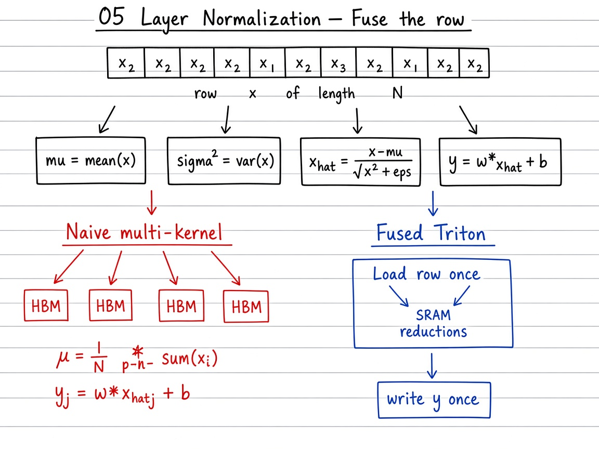

# 05 — Layer Normalization

> **Goal.** Fuse mean / variance / affine transform of layer-norm into one (or few) Triton kernels over the last dimension — one HBM load of the row, reductions in SRAM, then write $y$ (and optionally $\mu$, $r_{\mathrm{std}}$).

Official reference: [Layer Normalization](https://triton-lang.org/main/getting-started/tutorials/05-layer-norm.html)

**Study ladder (from the notes / visuals):**

1. **Naive multi-pass** — separate mean, variance, then normalize + affine (several DRAM sweeps)
2. **Fused row program (Python)** — one row at a time: $\mu\to\sigma^{2}\to y$ with local temps
3. **Blocked / masked** — power-of-two `BLOCK_SIZE` $\ge N$ with mask $j<N$
4. **Triton** — one program per row; FP32 reductions; store $\mu$ and $r=1/\sqrt{\sigma^{2}+\varepsilon}$ for backward

---

## Mathematical definition

For a row $x \in \mathbb{R}^{N}$ (hidden size $N$), weights $w,b \in \mathbb{R}^{N}$, and $\varepsilon > 0$:

$$
\mu = \frac{1}{N}\sum_{j=1}^{N} x_j, \qquad
\sigma^{2} = \frac{1}{N}\sum_{j=1}^{N} (x_j-\mu)^{2},
$$

$$
\hat{x}_j = \frac{x_j - \mu}{\sqrt{\sigma^{2}+\varepsilon}}, \qquad
y_j = w_j\,\hat{x}_j + b_j.
$$

In matrix form, for $X \in \mathbb{R}^{M\times N}$, apply the same independently to each row.

**Identity (optional one-pass form):**

$$
\sigma^{2} = \Bigl(\frac{1}{N}\sum_j x_j^{2}\Bigr) - \mu^{2}.
$$

**Welford / two-pass note.** Computing $\mu$ then $\sigma^{2}$ is a two-pass reduction; numerically stable one-pass algorithms exist. Training kernels also store $\mu$ and $r = 1/\sqrt{\sigma^{2}+\varepsilon}$ for the backward pass.

**Teaching example.** $M=4$ rows, $N=8$ hidden: grid of 4 programs; each loads 8 elements (or a 16-wide block with 8-lane mask), writes one normalized row.

---

## Visual: theory board



*Theory board — mean/var/affine as separate HBM passes vs one fused load/reduce/store.*

```
 x ──► mean μ, var σ² ──► normalize ──► *w + b ──► y
         ▲                    │
         └──── reductions ────┘   (keep in SRAM if N fits)
```

| Stage | DRAM sweeps of $x$ | Where stats live |
|-------|----------------------|------------------|
| Naive multi-pass | $\ge 3$ | intermediates in HBM |
| Fused Python | 1–2 | NumPy/Torch temps |
| Triton | $4N$ per row ($x,\gamma,\beta,y$); $2N$ only when $\gamma,\beta$ are L2-resident | SRAM / registers |

---

## Bandwidth intuition

Naive PyTorch may launch several kernels (mean, var, normalize, affine). Fusion keeps $x$ on-chip across reductions → fewer DRAM round-trips, similar spirit to fused softmax.

---

## Self-check (study)

1. Write $\mu$, $\sigma^{2}$, and $y_j=w_j\hat x_j+b_j$ for one row.
2. How does **RMSNorm** differ (one sentence)?
3. Why fuse mean and var with the affine — what traffic do you avoid?

---

## Common pitfalls

- Reducing over the wrong axis (batch vs hidden).
- Using a block size $< N$ without a multi-block reduction plan.
- Comparing to `F.layer_norm` with mismatched $\varepsilon$.

---

## Concrete teaching walk

Functions in this folder (names used by tests — do not rename):

| Function | Role |
|----------|------|
| `naive_layer_norm_pseudo` | Multi-pass / reference-style row norm |
| `fused_layer_norm_pseudo` | Single fused row computation in Python |
| `_layer_norm_fwd_kernel` / `layer_norm` | Triton forward + launcher |

Block size rule of thumb:

$$
B = \operatorname{next\_power\_of\_2}(N),\quad \text{mask } j < N.
$$

---

## Folder layout

| Path | Role |
|------|------|
| [`docs/README.md`](docs/README.md) | Gradients sketch, RMSNorm variant, exercises |
| [`docs/README.md`](docs/README.md) | Deeper formulas, pitfalls, and exercises |
| [`docs/images/`](docs/images/) | Whiteboard theory figures |
| [`05_layer_normalization.ipynb`](05_layer_normalization.ipynb) | Interactive ladder (naive → fused → Triton) |
| [`tutorial.py`](tutorial.py) | Forward fused kernel + tests |

```bash
cd 05_layer_normalization
jupyter notebook 05_layer_normalization.ipynb
# or
python tutorial.py
```
