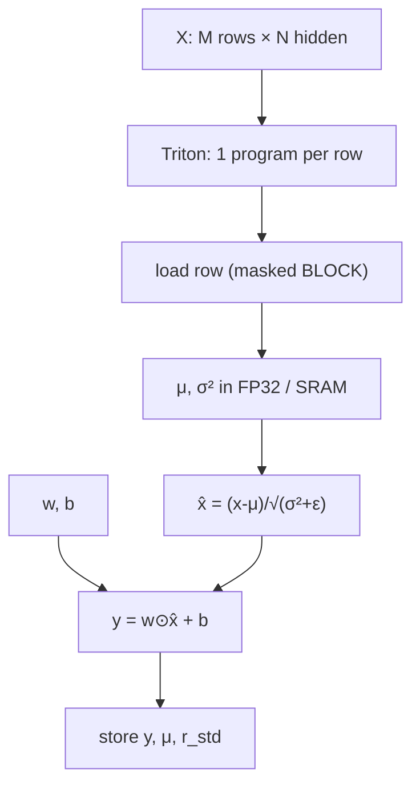
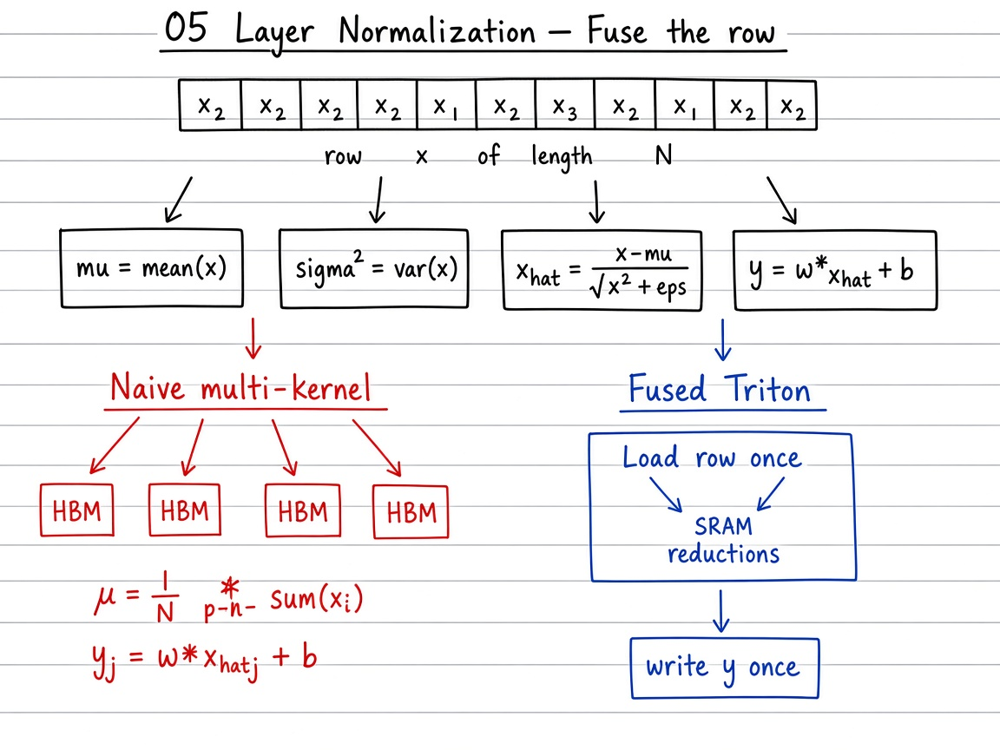

# Visual guide — Layer Normalization

This note complements the [official Triton tutorial](https://triton-lang.org/main/getting-started/tutorials/05-layer-norm.html).

## Goal

Learn layer-norm as a ladder: multi-pass stats over the row → fused per-row Python → masked power-of-two blocks → Triton forward that keeps \(\mu\) and \(r_{\mathrm{std}}\) for backward.

## Mental model

## Visual: theory board (method / logic)
## Theory board

*Theory board — mean/var/affine as separate HBM passes vs one fused load/reduce/store.*

*Theory board — mean/var/affine as separate HBM passes vs one fused load/reduce/store.*

## Step-by-step (what each phase does)

1. **Naive multi-pass** — Compute \(\mu\), then \(\sigma^{2}\), then normalize + affine. Correct, but each pass re-reads \(x\) from HBM (`naive_layer_norm_pseudo`).
2. **Fused row (Python)** — One function body per row: reductions then affine (`fused_layer_norm_pseudo`). Same numerics, fewer conceptual kernels.
3. **Blocking / masks** — Choose \(B=\mathrm{next\_power\_of\_2}(N)\). Load with mask \(j<N\) so odd \(N\) still works.
4. **Triton forward** — `pid = row`; FP32 mean/var; write \(y\) and often \(\mu\), \(r=(\sigma^{2}+\varepsilon)^{-1/2}\) for training.
5. **Benchmark** — Compare to `torch.nn.functional.layer_norm`; fusion wins when the kernel is **memory-bound** (typical for moderate \(N\)).

## Tips

- Prefer FP32 for \(\mu\) and \(\sigma^{2}\) even if \(x\) is FP16 — stability matters more than a few extra FLOPs.
- If \(N\) exceeds SRAM budget, you need multi-block reductions (advanced); the teaching kernel assumes one block covers \(N\).
- Centering property: \(x\leftarrow x+c\mathbf{1}\) leaves \(\hat{x}\) unchanged — a useful sanity check.
- Re-run `python scripts/download_tutorial_images.py` from the repo root if the benchmark figure is missing offline.

## See also

- Deep dive: [`README.md`](README.md) (RMSNorm, backward sketch, exercises)
- [Tutorials index](https://triton-lang.org/main/getting-started/tutorials/index.html)
- Repo notebook: `05_layer_normalization.ipynb`
