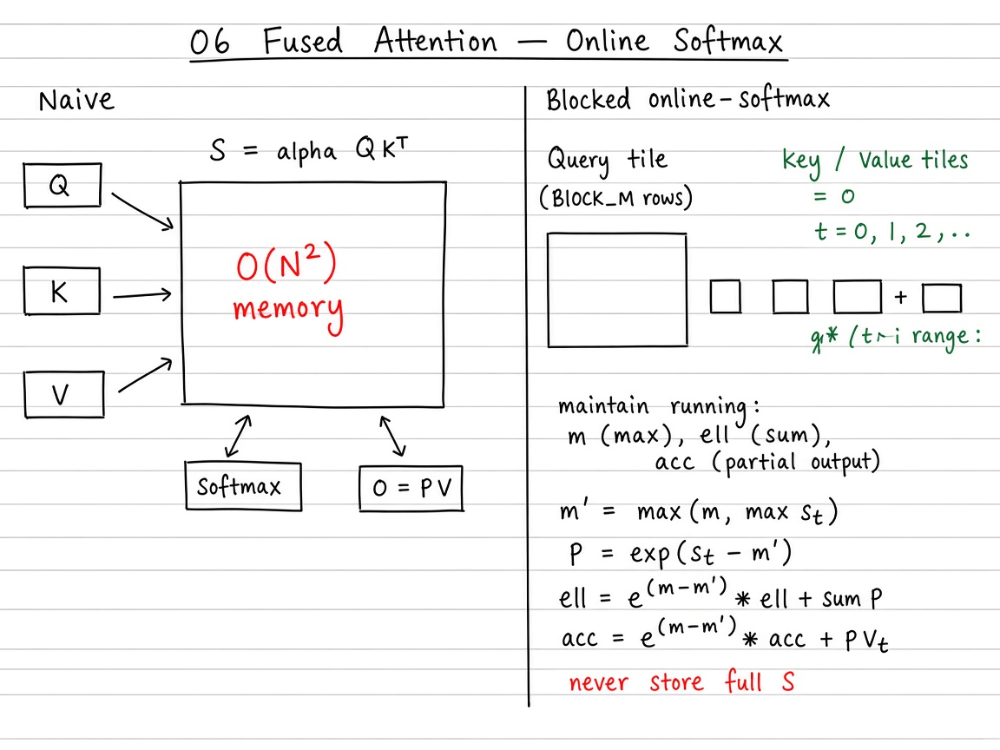

# 06 — Fused Attention (FlashAttention-style)

> **Goal.** Compute scaled dot-product attention **without** materializing the full $N\times N$ score matrix — use tiled matmuls + **online softmax** so working memory stays $O(Nd)$ instead of $O(N^{2})$.

Official reference: [Fused Attention](https://triton-lang.org/main/getting-started/tutorials/06-fused-attention.html)

**Study ladder (from the notes / visuals):**

1. **Naive** — form full $S=QK^{\top}/\sqrt{d}$, row-softmax → $P$, then $O=PV$ (stores $N\times N$)
2. **Blocked + online softmax** — stream $K,V$ tiles; keep running $(m,\ell,\mathrm{Acc})$ per $Q$-tile
3. **Causal / masked** — set future scores to $-\infty$ (or skip tiles beyond the diagonal)
4. **Triton** — fused forward kernel: SRAM tiles, online updates, write $O$ only

---

## Mathematical definition

For queries, keys, values $Q,K,V \in \mathbb{R}^{N\times d}$ (one head; batch/head dims omitted):

$$
S = \frac{QK^{\top}}{\sqrt{d}} \in \mathbb{R}^{N\times N}, \qquad
P = \operatorname{softmax}(S) \text{ (row-wise)}, \qquad
O = PV \in \mathbb{R}^{N\times d}.
$$

**Naive memory:** store $S$ or $P$ → $O(N^{2})$ — prohibitive for long context.

**FlashAttention idea:** tile along sequence length; keep running softmax statistics so each $Q$-tile streams over $K,V$ tiles with $O(Nd)$ working memory.

**Teaching example.** $N=128$, $d=64$, `BLOCK_M=BLOCK_N=32`: four $Q$-tiles along rows; each streams four $K/V$ tiles with online updates — never allocates a $128\times 128$ score buffer.

---

## Visual: theory board


*Theory board — $O(N^2)$ score matrix vs online-softmax tiles that never store full $S$.*

## Online softmax (core formulas)

Process key/value blocks $t = 1,2,\ldots$ with local scores $s^{(t)}$ for a fixed query tile. Maintain running max $m$, sum-of-exps $\ell$, and output accumulator $\mathrm{Acc}$:

$$
m^{(t)} = \max\bigl(m^{(t-1)},\, \max_j s^{(t)}_{j}\bigr),
$$

$$
\ell^{(t)} = e^{m^{(t-1)}-m^{(t)}}\,\ell^{(t-1)} + \sum_j e^{s^{(t)}_{j}-m^{(t)}},
$$

$$
\mathrm{Acc}^{(t)} = e^{m^{(t-1)}-m^{(t)}}\,\mathrm{Acc}^{(t-1)} + e^{s^{(t)}-m^{(t)}}\, V^{(t)}.
$$

(Initialize $m^{(0)}=-\infty$, $\ell^{(0)}=0$, $\mathrm{Acc}^{(0)}=0$.) After the last block,

$$
o = \frac{\mathrm{Acc}}{\ell}.
$$

**Why the scale factor?** Softmax is shift-invariant. When the running max increases, previous $\ell$ and $\mathrm{Acc}$ were computed under the old max; multiplying by $e^{m_{\mathrm{old}}-m_{\mathrm{new}}}$ renormalizes them to the new max — algebraically identical to softmax over the concatenation of all score blocks (up to FP error).

---

## Visual: tiled attention



*Theory board — $O(N^2)$ score matrix vs online-softmax tiles that never store full $S$.*

```
 Q-tile (BM × d)
        │
        ▼
   for each K/V tile (BN × d):
        S_tile = Q @ Kᵀ / √d
        update (m, ℓ, Acc) via online softmax
        │
        ▼
   O-tile = Acc / ℓ
```

| Stage | Materializes $S$? | Memory (activations) |
|-------|---------------------|----------------------|
| Naive | yes, $N\times N$ | $O(N^{2})$ |
| Blocked online | no (tile only) | $O(Nd + B_M B_N)$ scratch |
| Triton fused | no | $O(Nd)$ outputs + SRAM tiles |

Causal mask: ignore key positions $j > i$ (or set scores to $-\infty$).

---

## Self-check (study)

1. Why is materializing $S=\alpha QK^{\top}$ bad for long $N$?
2. Write the online-softmax update for $m'$, $\ell$, and $\mathrm{Acc}$ when a new score tile arrives.
3. After the last key tile, how do you form the output tile $O$?

---

## Common pitfalls

- Forgetting the rescale $e^{m_{\mathrm{old}}-m_{\mathrm{new}}}$ when the running max increases.
- Causal mask off-by-one on the diagonal.
- Comparing FP16 fused attention to FP32 naive without loosening `allclose` tolerances.

---

## Concrete teaching walk

Functions in this folder (names used by tests — do not rename):

| Function | Role |
|----------|------|
| `naive_attention_pseudo` | Full $S$, softmax, $PV$ |
| `blocked_attention_pseudo` | Tiled loop + online softmax in Python |
| `_attn_fwd_kernel` / `attention` | Triton fused forward + launcher |

---

## Folder layout

| Path | Role |
|------|------|
| [`docs/README.md`](docs/README.md) | Online softmax proof sketch, complexity, exercises |
| [`docs/visual-guide.md`](docs/visual-guide.md) | Mermaid mental model + benchmark walkthrough |
| [`docs/images/`](docs/images/) | Whiteboard theory figures |
| [`06_fused_attention.ipynb`](06_fused_attention.ipynb) | Interactive ladder (naive → blocked → Triton) |
| [`tutorial.py`](tutorial.py) | Reference + learning kernel + tests |

```bash
cd 06_fused_attention
jupyter notebook 06_fused_attention.ipynb
# or
python tutorial.py
```
