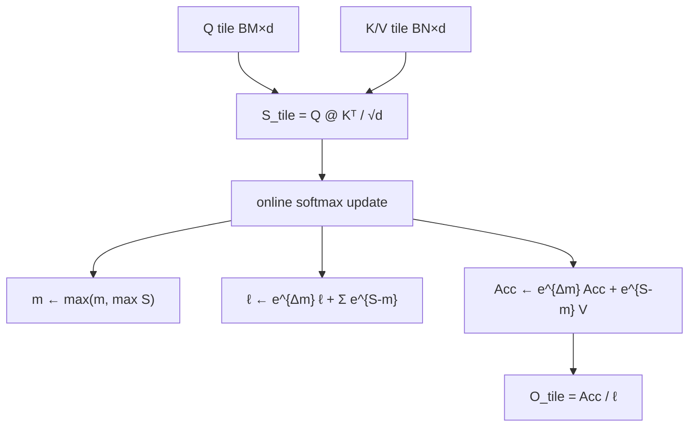
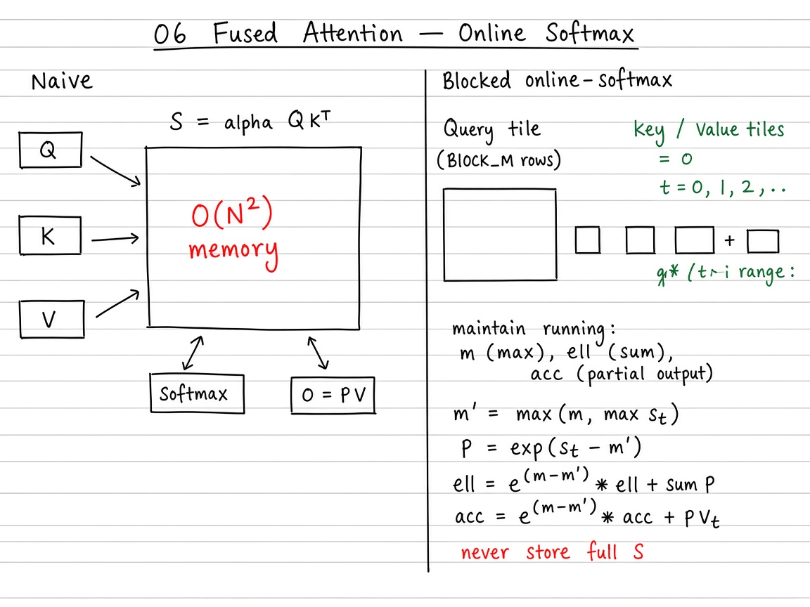

# Visual guide — Fused Attention

This note complements the [official Triton tutorial](https://triton-lang.org/main/getting-started/tutorials/06-fused-attention.html).

## Goal

Learn FlashAttention-style attention as a ladder: full \(QK^{\top}\) → blocked tiles with **online softmax** → causal masking → Triton fused forward that never stores the \(N\times N\) score matrix.

## Mental model

## Visual: theory board (method / logic)
## Theory board

*Theory board — $O(N^2)$ score matrix vs online-softmax tiles that never store full $S$.*

*Theory board — $O(N^2)$ score matrix vs online-softmax tiles that never store full $S$.*

## Step-by-step (what each phase does)

1. **Naive** — Allocate \(S\in\mathbb{R}^{N\times N}\), \(P=\mathrm{softmax}(S)\), \(O=PV\) (`naive_attention_pseudo`). Clear algebra; \(O(N^{2})\) memory.
2. **Blocked + online softmax** — For each \(Q\)-tile, loop \(K/V\)-tiles; update \((m,\ell,\mathrm{Acc})\) with the rescale \(e^{m_{\mathrm{old}}-m_{\mathrm{new}}}\) (`blocked_attention_pseudo`).
3. **Finalize** — \(O_{\mathrm{tile}}=\mathrm{Acc}/\ell\). Matches full softmax attention up to floating-point error.
4. **Causal (optional)** — Mask \(j>i\) with \(-\infty\) before the exp; skip pure-future \(K\)-tiles when possible.
5. **Triton** — Same algebra in SRAM: load tiles, `tl.dot`, online stats, store \(O\) only.
6. **Benchmark** — Same FLOPs order \(O(N^{2}d)\); speedups are **IO** (fewer HBM trips), not fewer FLOPs.

## Tips

- Implement the pure-PyTorch blocked loop first; only then read the fused Triton kernel — the online updates are the hard part.
- Initialize \(m=-\infty\), \(\ell=0\), \(\mathrm{Acc}=0\); forgetting the \(e^{\Delta m}\) rescale is the #1 bug.
- Teaching sizes: \(N=128\), \(d=64\), `BLOCK_M=BLOCK_N=32` before jumping to long context.
- Re-run `python scripts/download_tutorial_images.py` from the repo root if the benchmark figure is missing offline.

## See also

- Deep dive: [`README.md`](README.md) (complexity table, proof sketch, exercises)
- [Tutorials index](https://triton-lang.org/main/getting-started/tutorials/index.html)
- Repo notebook: `06_fused_attention.ipynb`
