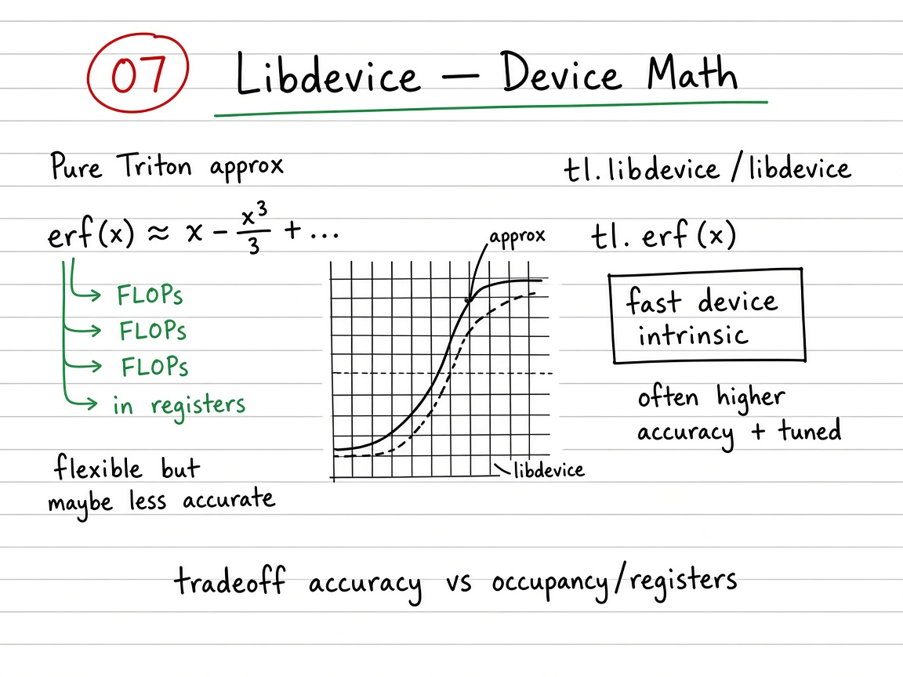

# 07 — Libdevice Special Functions

> **Goal.** Call high-quality GPU math from Triton via `tl.extra.libdevice` (e.g. $\operatorname{erf}$, $\tanh$) when builtins are missing or less accurate — and understand the accuracy / throughput tradeoff vs pure Triton polynomial approximations.

Official reference: [Libdevice](https://triton-lang.org/main/getting-started/tutorials/07-libdevice.html)
(also listed historically as [Extern functions](https://triton-lang.org/main/getting-started/tutorials/07-extern-functions.html))

**Study ladder (from the notes / visuals):**

1. **Naive** — Python loop with `math.erf` (exact GELU formula, host-side)
2. **Vectorized torch** — same formula with `torch.erf` (still not a custom kernel)
3. **Triton + libdevice** — elementwise kernel: `tl.load` → `libdevice.erf` → store
4. **Tradeoff** — compare vs tanh / poly approximations for accuracy and GB/s

---

## Mathematical definition

The Gaussian Error Linear Unit (exact / erf form):

$$
\operatorname{GELU}(x) = x\,\Phi(x)
= \tfrac{1}{2}\,x\left(1 + \operatorname{erf}\!\left(\frac{x}{\sqrt{2}}\right)\right),
$$

where $\Phi$ is the standard normal CDF and

$$
\operatorname{erf}(z) = \frac{2}{\sqrt{\pi}}\int_0^{z} e^{-t^{2}}\,\mathrm{d}t.
$$

With $\frac{1}{\sqrt{2}} \approx 0.7071067811865476$, the Triton path is:

$$
x \xrightarrow{\texttt{tl.load}}
\operatorname{libdevice.erf}(x/\sqrt{2})
\xrightarrow{\text{scale}}
y = \tfrac{1}{2}\,x\,(1+\operatorname{erf}(\cdot))
\xrightarrow{\texttt{tl.store}}
y.
$$

**Alternate (tanh) approximation** often used in frameworks:

$$
\operatorname{GELU}_{\tanh}(x)=\tfrac{1}{2}x\left(1+\tanh\!\left(\sqrt{\tfrac{2}{\pi}}\bigl(x+0.044715\,x^{3}\bigr)\right)\right).
$$

**Running example:** $x \in \mathbb{R}^{8192}$ (FP32) on device; block size $B=1024$ → $\lceil N/B\rceil = 8$ programs.

| Stage | How $\operatorname{erf}$ is evaluated | Where it runs |
|-------|------------------------------------------|---------------|
| Naive | `math.erf` in a Python loop | Host CPU |
| Torch | `torch.erf` (vectorized) | GPU / ATen |
| Triton | `libdevice.erf` after `tl.load` | Triton program + CUDA math lib |

---

## Visual: theory board



*Theory board — polynomial/tanh approximations vs `tl.extra.libdevice` intrinsics (accuracy / speed tradeoff).*

Libdevice wins when you need a special function that is awkward to approximate accurately in a few FLOPs; pure `tl` polys can win when the kernel is already compute-bound and a few ULPs of error are acceptable.

---

## Self-check (study)

Before leaving this folder, answer without looking:

1. Write $\operatorname{GELU}(x)$ with $\operatorname{erf}$. Why divide by $\sqrt{2}$?
2. Name one case where a **tanh poly** is preferable to `libdevice.erf`.
3. Is a huge FP32 GELU usually **memory-bound** or **compute-bound**? What does that imply for accuracy choice?

---

## Common pitfalls

- Comparing to `F.gelu` without matching `approximate=` (`'none'` vs `'tanh'`).
- Timing tiny $N$ (launch noise) and concluding libdevice is “slow.”
- Forgetting FP32 accumulate / cast when mixing dtypes.

---

## When to use libdevice

| Need | Prefer |
|------|--------|
| Fast approximate `exp`/`log` | `tl.exp`, `tl.log` |
| Special functions (`erf`, high-accuracy `sin`, …) | `tl.extra.libdevice` |
| Custom poly approx (tanh GELU, etc.) | Hand-written `tl` arithmetic |
| Memory-bound huge tensors | Accuracy “for free” — pick the clearer formula |
| Tiny tensors / launch-dominated | Call overhead + occupancy matter more |

---

## Concrete teaching walk

1. Prove $\operatorname{GELU}(x)=x\Phi(x)$ equals the erf form above.
2. Implement the three ladder stages; check `allclose` vs `torch.nn.functional.gelu`.
3. Optionally swap `libdevice.erf` for a tanh poly and plot $\lvert\operatorname{GELU}_{\text{erf}}-\operatorname{GELU}_{\tanh}\rvert$ on $[-5,5]$.
4. Bench GB/s: libdevice GELU vs pure-`tl` tanh approx on large $N$.

---

## Folder layout

| Path | Role |
|------|------|
| [`docs/README.md`](docs/README.md) | GELU variants, accuracy notes, exercises |
| [`docs/visual-guide.md`](docs/visual-guide.md) | Mermaid + benchmark walkthrough |
| [`docs/images/`](docs/images/) | Whiteboard theory figures |
| [`07_libdevice.ipynb`](07_libdevice.ipynb) | Full interactive tutorial |
| [`tutorial.py`](tutorial.py) | GELU kernel script |

```bash
cd 07_libdevice
jupyter notebook 07_libdevice.ipynb
# or
python tutorial.py
```
