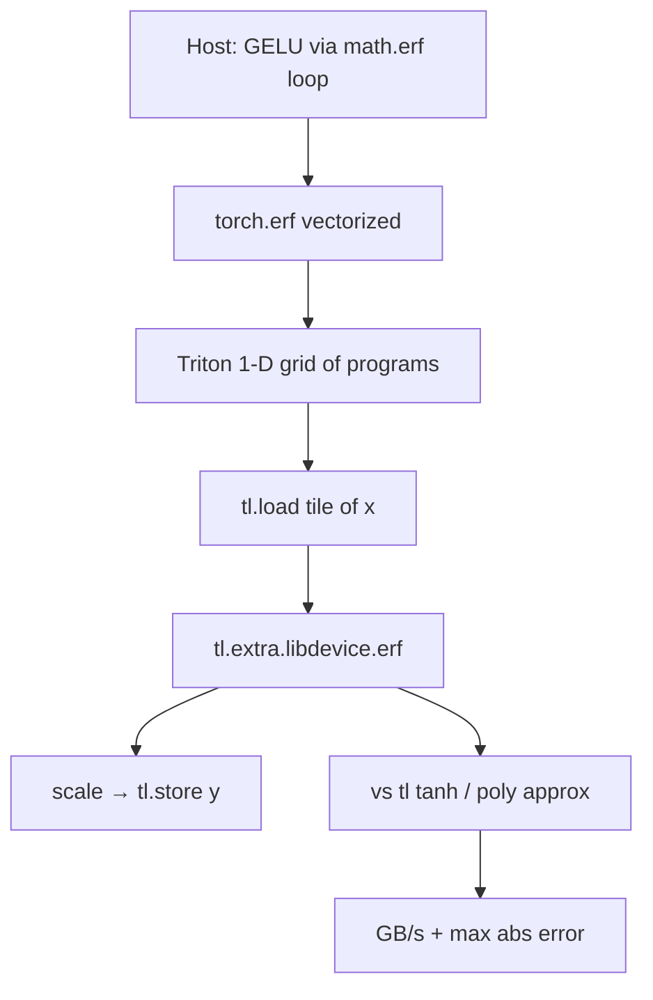
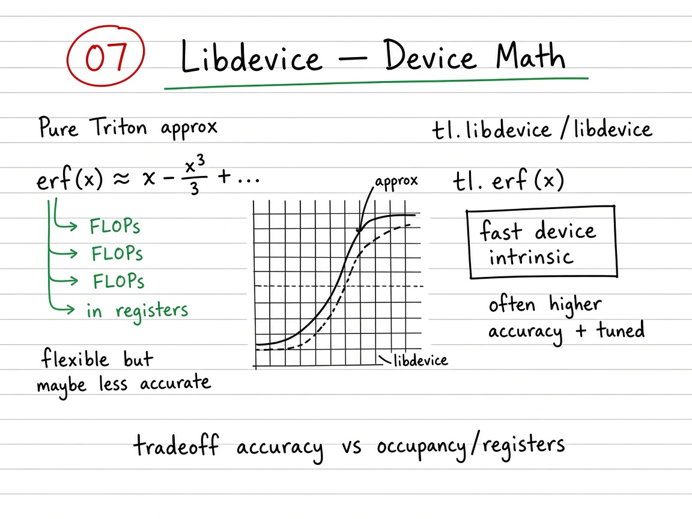

# Visual guide — Libdevice Functions

This note complements the [official Triton tutorial](https://triton-lang.org/main/getting-started/tutorials/07-libdevice.html)
([extern-functions slug](https://triton-lang.org/main/getting-started/tutorials/07-extern-functions.html)).

## Goal

Learn device special functions as a ladder: host `math.erf` → vectorized `torch.erf` → Triton `tl.extra.libdevice` — then judge accuracy vs throughput against pure Triton approximations (`tanh` / polys).

## Mental model

## Visual: theory board (method / logic)
## Theory board

*Theory board — polynomial/tanh approximations vs `tl.extra.libdevice` intrinsics (accuracy / speed tradeoff).*

*Theory board — polynomial/tanh approximations vs `tl.extra.libdevice` intrinsics (accuracy / speed tradeoff).*

Special-function kernels are often still **memory-bound** at large \(N\): then a more accurate libdevice call costs little extra wall time. At small \(N\), launch + call overhead dominate and a fused poly may look faster.

## Step-by-step (what each phase does)

1. **Naive** — Flatten \(x\); for each \(i\), \(y_i=\tfrac12 x_i(1+\operatorname{erf}(x_i/\sqrt{2}))\) with `math.erf`. Correct reference; not a GPU kernel.
2. **Torch** — Same formula with `torch.erf` — vectorized ATen, still no custom Triton.
3. **Triton + libdevice** — Program \(p\) owns offsets \(pB+\{0,\ldots,B-1\}\); mask \(offsets < N\); `libdevice.erf(x * 0.7071…)`; store GELU.
4. **Correctness** — `torch.allclose` vs `F.gelu` (atol/rtol \(\sim 10^{-2}\) for FP32 device path is typical in the notebook tests).
5. **Benchmark / tradeoff** — Compare libdevice GELU vs tanh approximation: plot abs error on \([-5,5]\); bench GB/s on large \(N\).

## Tips

- Prefer libdevice when the closed form needs a special function you do not want to re-derive (erf, erfc, …).
- Prefer pure `tl` when you already accept a published approximation (tanh GELU) and want every FLOP under your control.
- Powers-of-two `BLOCK_SIZE` (e.g. 1024) map cleanly; always mask the remainder.
- Re-run `python scripts/download_tutorial_images.py` if figures are missing offline.

## See also

- [Tutorials index](https://triton-lang.org/main/getting-started/tutorials/index.html)
- Deep dive: [`README.md`](README.md)
- Repo notebook: `07_libdevice.ipynb`
