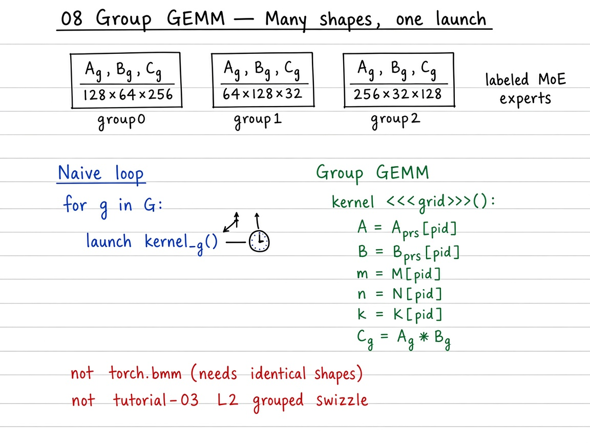

# 08 — Group GEMM

> **Goal.** Run many independent GEMMs $C_g = A_g B_g$ with **different** shapes $(M_g,N_g,K_g)$ efficiently (MoE experts, multi-LoRA, batched irregular matmuls) — one pointer table / launch instead of $G$ host launches.

Official reference: [Group GEMM](https://triton-lang.org/main/getting-started/tutorials/08-group-gemm.html)

**Study ladder (from the notes / visuals):**

1. **Naive** — sequential `torch.matmul` per $(A_g,B_g)$ (correct; $G$ launches)
2. **Sequential Triton** — same loop, each call is tutorial-03 grouped matmul
3. **Group GEMM** — one launch; device arrays of pointers + $(M_g,N_g,K_g)$
4. **Contrast** — not `torch.bmm` (requires identical shapes); not tutorial-03 “grouped” L2 swizzle

---

## Mathematical definition

For groups $g = 1,\ldots,G$:

$$
A_g \in \mathbb{R}^{M_g \times K_g},\quad
B_g \in \mathbb{R}^{K_g \times N_g},\quad
C_g = A_g B_g \in \mathbb{R}^{M_g \times N_g}.
$$

Unlike a stacked batch GEMM (same $M,N,K$ for all), **group GEMM** allows heterogeneous sizes. Total FLOPs:

$$
\sum_{g=1}^{G} 2\,M_g N_g K_g.
$$

**Launch cost model (sketch).** Sequential launches pay $\approx G\cdot T_{\mathrm{launch}}$ plus compute. When problems are small, $G\cdot T_{\mathrm{launch}}$ dominates. A single-launch Group GEMM packs metadata so one grid covers all $g$.

**Naming note.** Tutorial 03’s “grouped” ordering is an **L2 swizzle inside one GEMM**. Group GEMM is a **batch of many GEMMs**. See [`../03_matrix_multiplication/README.md`](../03_matrix_multiplication/README.md).

**Running example (notebook / baseline):**

| $g$ | $A_g$ | $B_g$ | $C_g$ |
|-------|---------|---------|---------|
| 0 | $128\times 64$ | $64\times 256$ | $128\times 256$ |
| 1 | $64\times 128$ | $128\times 32$ | $64\times 32$ |

---

## Visual: theory board



*Theory board — sequential launches vs device arrays of pointers + $(M_g,N_g,K_g)$ in one kernel.*

## Visual: one launch, many shapes

```
 Group 0:  (128×64) @ (64×256)
 Group 1:  (64×128) @ (128×32)
 Group 2:  (256×256) @ (256×128)
        \         |         /
         └── one launch / pointer table ──┘
```

Host builds device arrays of pointers and sizes; the kernel indexes by group id (or a work queue — related to tutorial 09).

---

## Self-check (study)

1. Why can Group GEMM shapes differ while `torch.bmm` cannot?
2. Is tutorial **03 “grouped”** the same as **Group GEMM**? One sentence each.
3. When do $G$ sequential launches hurt more: tiny experts or huge ones?

---

## Common pitfalls

- Confusing **L2 grouped pid (03)** with **multi-problem Group GEMM (08)**.
- Assuming this folder’s sequential Triton loop is already the official one-launch kernel — it is the **baseline**. The notebook and `tutorial.py` also include a packed pointer-table launch (`group_gemm_one_launch`); it is a teaching sketch, not a tuned production kernel.
- Padding all $M_g$ to $\max M_g$ without counting wasted FLOPs.

---

## Why not `torch.bmm`?

| API | Shapes | Typical use |
|-----|--------|-------------|
| `torch.bmm` / batched GEMM | Identical $(M,N,K)$ per batch | Dense batched linear |
| **Group GEMM** | Different $(M_g,N_g,K_g)$ | MoE experts, multi-LoRA |
| Padded + mask | Pad to $\max M_g$ etc. | Simple but wastes FLOPs/memory |

MoE experts often have different token counts $M_g$ → group GEMM or padded batch + masks (wasteful).

---

## Concrete teaching walk

1. Build a list of $(A_g,B_g)$ with mismatched shapes; verify sequential torch.
2. Swap each call for tutorial-03 `matmul` — still $G$ launches, same $C_g$.
3. Build the pointer table (`A_off[g]`, `B_off[g]`, `C_off[g]`, `M[g]`, `N[g]`, `K[g]`) and launch one grid over all tiles.
4. Read the official one-launch kernel; contrast schedule with persistent workers (09).

---

## Folder layout

| Path | Role |
|------|------|
| [`docs/README.md`](docs/README.md) | MoE connection, scheduling, exercises |
| [`docs/visual-guide.md`](docs/visual-guide.md) | Mermaid + benchmark walkthrough |
| [`docs/images/`](docs/images/) | Whiteboard theory figures |
| [`08_group_gemm.ipynb`](08_group_gemm.ipynb) | Full interactive tutorial |
| [`tutorial.py`](tutorial.py) | Sequential baseline using tutorial 03 |

```bash
cd 08_group_gemm
jupyter notebook 08_group_gemm.ipynb
# or
python tutorial.py
```
