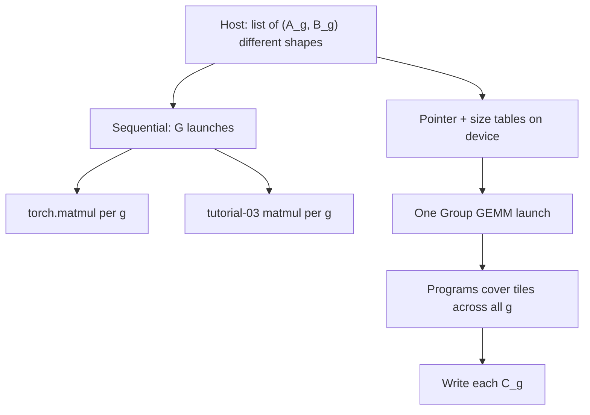
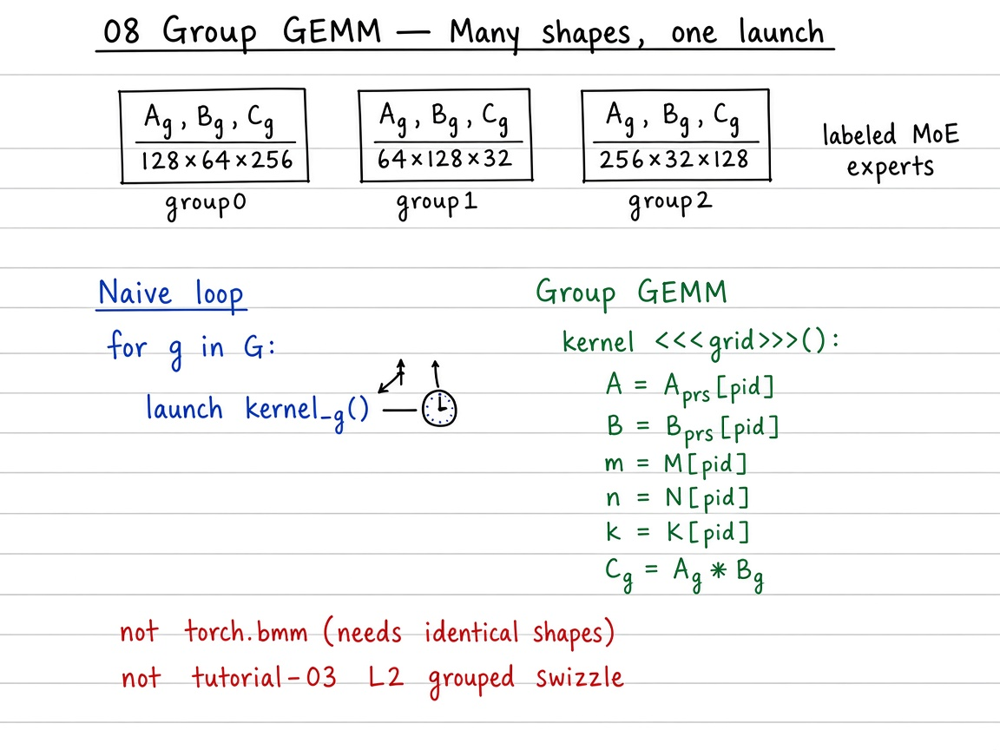

# Visual guide — Group GEMM

This note complements the [official Triton tutorial](https://triton-lang.org/main/getting-started/tutorials/08-group-gemm.html).

## Goal

Learn batched irregular GEMMs as a ladder: sequential torch → sequential tutorial-03 matmul → one-launch Group GEMM with a pointer table — and contrast with `torch.bmm` (fixed shapes) and tutorial 03’s L2 “grouped” swizzle.

## Mental model

## Visual: theory board (method / logic)
## Theory board

*Theory board — sequential launches vs device arrays of pointers + $(M_g,N_g,K_g)$ in one kernel.*

*Theory board — sequential launches vs device arrays of pointers + $(M_g,N_g,K_g)$ in one kernel.*

When \(G\) is large and each GEMM is small/medium, launch amortization dominates. When each problem is huge, sequential Triton (or cuBLAS) already saturates the GPU and Group GEMM’s win shrinks.

## Step-by-step (what each phase does)

1. **Naive sequential** — For each \(g\): \(C_g = A_g B_g\) via `torch.matmul`. Correct Cartesian product of independent problems; pays \(G\) launches.
2. **Sequential Triton** — Same loop with tutorial-03 grouped matmul ([`03_matrix_multiplication`](../../03_matrix_multiplication/README.md)). Algebra unchanged; still \(G\) grids.
3. **Metadata** — Host packs `A_ptr[g]`, `B_ptr[g]`, `C_ptr[g]`, \(M_g,N_g,K_g\) (and strides) into device arrays.
4. **One-launch Group GEMM** — Programs read group metadata, run the familiar \(B_M\times B_N\) tile body (K-panels + `tl.dot`) for whichever problem they own.
5. **Correctness / bench** — `allclose` each \(C_g\) vs torch; compare TFLOPS / latency of sequential vs grouped launch.

## Tips

- Do **not** confuse with tutorial 03 `GROUP_SIZE_M` — that only reorders tiles **inside one** GEMM for L2 reuse.
- `torch.bmm` needs identical shapes; for MoE-like \(M_g\) variation, group GEMM or pad+mask.
- Persistent work queues (tutorial 09) compose naturally: steal the next unfinished group/tile.
- Re-run `python scripts/download_tutorial_images.py` if figures are missing offline.

## See also

- [Tutorials index](https://triton-lang.org/main/getting-started/tutorials/index.html)
- Matmul primer: [`../../03_matrix_multiplication/README.md`](../../03_matrix_multiplication/README.md)
- Deep dive: [`README.md`](README.md)
- Repo notebook: `08_group_gemm.ipynb`
