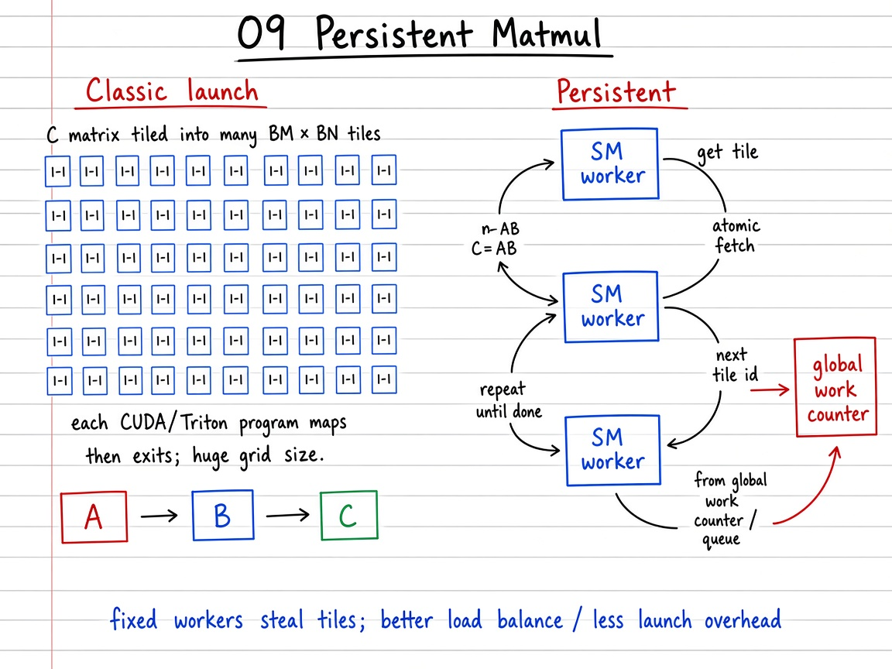

# 09 — Persistent Matmul

> **Goal.** Understand **persistent** CTA/program style GEMM: fewer grid programs, each pulls many output tiles from a work queue (static stride or `atomicAdd`) — amortizes launch and improves wave scheduling. Same math $C=AB$ as tutorial 03; different **who-runs-what**.

Official reference: [Persistent Matmul](https://triton-lang.org/main/getting-started/tutorials/09-persistent-matmul.html)

**Study ladder (from the notes / visuals):**

1. **Classic** — one program per $C$-tile (tutorial 03 launch: grid $=\lceil M/B_M\rceil\lceil N/B_N\rceil$)
2. **Persistent (pseudo)** — $P\ll T$ workers; each strides `tile_id = pid, pid+P, …`
3. **Triton persistent** — `tl.num_programs` loop; optional atomic work queue / “tile stealing”
4. **Compose** — same tile body + grouped L2 swizzle from 03; queues also power Group GEMM (08)

---

## Mathematical / systems view

Classic tiled GEMM launches

$$
\#\text{programs} = T = \left\lceil\frac{M}{B_M}\right\rceil\left\lceil\frac{N}{B_N}\right\rceil
$$

— one program per $C$-tile.

**Persistent:** launch $P \approx \#\text{SMs}\times\text{occupancy}$ long-lived programs ($P\ll T$). Each repeatedly claims a tile and runs the same blocked product:

$$
C\big[p_m B_M:(p_m+1)B_M,\; p_n B_N:(p_n+1)B_N\big]
=
\sum_t A_t B_t
$$

(with $K$-panels as in [`../03_matrix_multiplication/README.md`](../03_matrix_multiplication/README.md)).

**Static stride schedule** (notebook pseudo / teaching kernel):

$$
\text{tiles}(p)=\{p,\,p+P,\,p+2P,\,\ldots\}\cap\{0,\ldots,T-1\}.
$$

**Work-queue / stealing schedule** (official style): 

$$
\text{tile\_id}\leftarrow\operatorname{atomicAdd}(\text{counter}),
\quad\text{compute }C\text{-tile}(\text{tile\_id}),
$$

until tiles are exhausted — load-balances when tile costs vary.

**Coverage lemma (stride).** $\bigcup_p\{p+kP:k\ge 0,\,p+kP<T\}=\{0,\ldots,T-1\}$.

**Running example:** $M=64$, $N=48$, $B_M=32$, $B_N=16$ → $T=2\cdot 3=6$ tiles; $P=3$ programs each take 2 tiles.

---

## Visual: theory board



*Theory board — huge 1:1 tile grid vs few resident programs that steal tiles from a work queue.*

## Visual: classic vs persistent

```
 Classic:  one program ↔ one C-tile ↔ short lifetime

 Persistent:
   SM programs stay alive
        │
        ├─ tile 17
        ├─ tile 42
        └─ tile 108 ...
```

---

## Self-check (study)

1. If $T=1000$ tiles and $P=80$ programs (static stride), about how many tiles does program 0 own?
2. When is an **atomic work queue** better than static stride $p, p+P, \ldots$?
3. Does persistence change the math of $C=AB$? What does it change?

---

## Common pitfalls

- Launching $P > T$ “just in case” (idle programs; confusing occupancy story).
- Forgetting the same **tile body** as 03 (only the outer schedule changes).
- Expecting huge wins when each tile already runs for a long time ($t_{\mathrm{comp}}\gg$ launch).

---

## When it helps

| Situation | Persistence helps? |
|-----------|--------------------|
| Many small/medium tiles; launch / wave overhead visible | Yes |
| Huge tiles; $t_{\mathrm{comp}}\gg L$ | Less so |
| Pipelining producer–consumer / epilogues | Yes |
| Irregular tile costs (Group GEMM, 08) | Atomic queues shine |

---

## Concrete teaching walk

1. Count $T$ for a teaching shape; launch classic tutorial-03 matmul.
2. Run `persistent_matmul_pseudo` with $P=3$; verify `allclose` vs $AB$.
3. Map `tile_id → (pid_m, pid_n)` and optionally apply 03’s grouped swizzle.
4. Read the official kernel’s work queue / atomics path.

---

## Folder layout

| Path | Role |
|------|------|
| [`docs/README.md`](docs/README.md) | Work queues, atomics, exercises |
| [`docs/visual-guide.md`](docs/visual-guide.md) | Mermaid + benchmark walkthrough |
| [`docs/images/`](docs/images/) | Whiteboard theory figures |
| [`09_persistent_matmul.ipynb`](09_persistent_matmul.ipynb) | Full interactive tutorial |
| [`tutorial.py`](tutorial.py) | Baseline via tutorial 03 matmul |

```bash
cd 09_persistent_matmul
jupyter notebook 09_persistent_matmul.ipynb
# or
python tutorial.py
```
