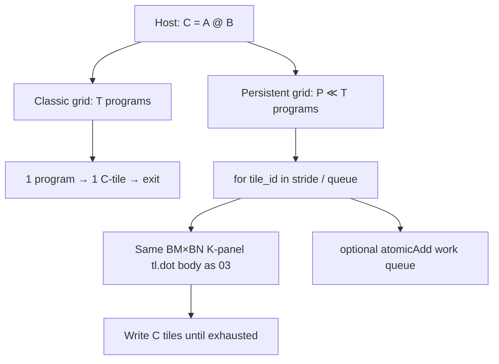
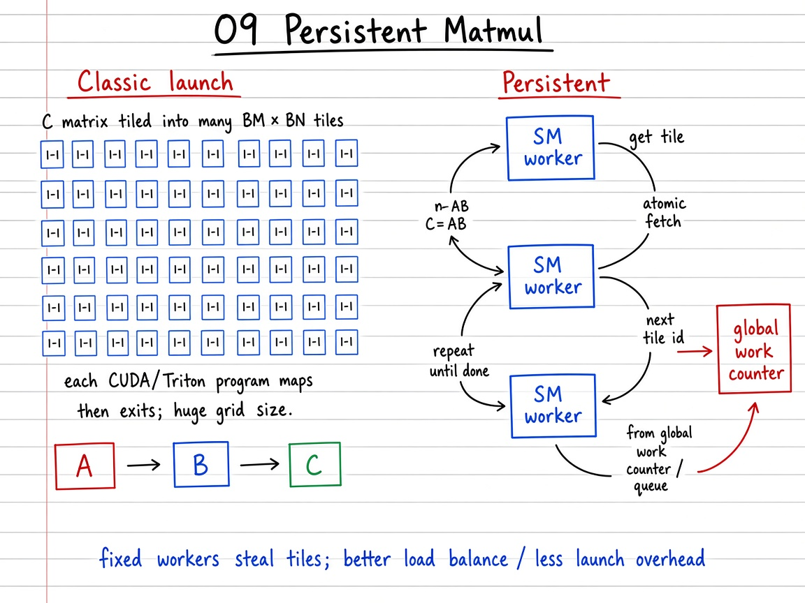

# Visual guide — Persistent Matmul

This note complements the [official Triton tutorial](https://triton-lang.org/main/getting-started/tutorials/09-persistent-matmul.html).

## Goal

Learn persistent GEMM scheduling: classic one-program-per-tile → few resident programs that steal many tiles → Triton `tl.num_programs` / work-queue kernels — same \(C=AB\) algebra as tutorial 03.

## Mental model

## Visual: theory board (method / logic)
## Theory board

*Theory board — huge 1:1 tile grid vs few resident programs that steal tiles from a work queue.*

*Theory board — huge 1:1 tile grid vs few resident programs that steal tiles from a work queue.*

Persistence changes **schedule**, not numerics. Combine with tutorial 03’s grouped pid swizzle for L2 locality once a `tile_id` is claimed.

## Step-by-step (what each phase does)

1. **Classic baseline** — Grid size \(T=G_M G_N\); program \(p\) owns tile \(p\) once (tutorial 03 `matmul`).
2. **Persistent pseudo** — \(P\) Python “workers”; each takes tiles \(p, p+P, \ldots\); writes the same blocks of \(C\).
3. **Index map** — \(\mathrm{pid}_m=\lfloor\mathrm{tile\_id}/G_N\rfloor\), \(\mathrm{pid}_n=\mathrm{tile\_id}\bmod G_N\) (or grouped swizzle from 03).
4. **Triton kernel** — `pid = tl.program_id(0)`, `num_pid = tl.num_programs(0)`, loop `range(pid, num_tiles, num_pid)` with the usual pointer/`tl.dot`/store body.
5. **Work queue (official)** — replace stride with `atomicAdd` on a global counter so faster SMs steal more tiles.
6. **Correctness / bench** — `allclose` vs `torch.matmul`; compare classic vs persistent on small (\(256\)) vs large (\(4096\)) squares.

## Tips

- If \(t_{\mathrm{comp}}\gg\) launch cost, persistence alone will not move the needle — profile before rewriting.
- Histogram tiles-per-program to see load balance (stride is even; atomics adapt).
- Cross-link: Group GEMM (08) often wants persistent workers over irregular groups.
- Re-run `python scripts/download_tutorial_images.py` if figures are missing offline.

## See also

- [Tutorials index](https://triton-lang.org/main/getting-started/tutorials/index.html)
- Matmul primer: [`../../03_matrix_multiplication/README.md`](../../03_matrix_multiplication/README.md)
- Deep dive: [`README.md`](README.md)
- Repo notebook: `09_persistent_matmul.ipynb`
