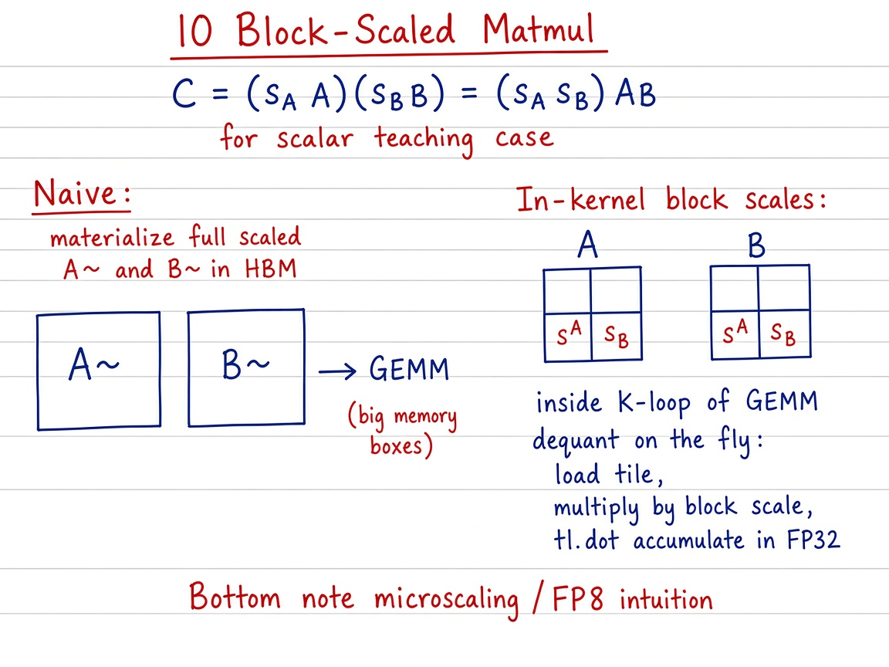

# 10 — Block-Scaled Matrix Multiplication

> **Goal.** Multiply low-precision matrices (e.g. FP8) where **scale factors** live per block (microscaling), reconstructing approximate higher-precision products — from the teaching identity $C=(s_A A)(s_B B)=(s_A s_B)AB$ up to in-kernel block scales fused into the GEMM $K$-loop.

Official reference: [Block Scaled Matrix Multiplication](https://triton-lang.org/main/getting-started/tutorials/10-block-scaled-matmul.html)

**Study ladder (from the notes / visuals):**

1. **Naive** — materialize $\tilde A=s_A A$, $\tilde B=s_B B$, then $\tilde A\tilde B$
2. **Intermediate** — same scaling in PyTorch; GEMM via tutorial-03 Triton matmul
3. **Triton scale sketch** — tiny `y = x * s` kernel, then grouped matmul
4. **In-kernel block scales / FP8** — per-block $s^A,s^B$ fused into loads / MMA (official tutorial)

---

## Mathematical definition

**Scalar teaching form.** For $s_A,s_B\in\mathbb{R}$ and $A\in\mathbb{R}^{M\times K}$, $B\in\mathbb{R}^{K\times N}$:

$$
C = (s_A A)\,(s_B B) = (s_A s_B)\,(AB).
$$

**Homogeneity.** Scaling inputs by constants factors out of the bilinear map — exact in real arithmetic; FP only reorders rounding.

**Block / microscaling form.** Store low-precision payloads $A^{\mathrm{lp}},B^{\mathrm{lp}}$ plus higher-precision scales. For a block $\mathcal{B}$:

$$
A^{\mathrm{approx}}_{ij} = s^{(\mathcal{B})}_A \cdot A^{\mathrm{lp}}_{ij}.
$$

If tile $(p_m,t)$ of $A$ has scale $s^{A}_{p_m,t}$ and tile $(t,p_n)$ of $B$ has $s^{B}_{t,p_n}$,

$$
C_{p_m,p_n}
=
\sum_t
\bigl(s^{A}_{p_m,t}\, A_{p_m,t}\bigr)
\bigl(s^{B}_{t,p_n}\, B_{t,p_n}\bigr),
$$

with dequant fused into the $K$-loop (official path) instead of writing full FP16 copies of $A,B$. Same blocked structure as [`../03_matrix_multiplication/README.md`](../03_matrix_multiplication/README.md).

**Running example (notebook):** $M=256$, $K=128$, $N=512$, $s_A=0.5$, $s_B=2.0$ → $C=(s_A s_B)AB = AB$.

---

## Visual: theory board



*Theory board — materialize scaled $A,B$ vs dequant with per-block scales inside the $K$-loop.*

## Why block scales?

| Scaling | Memory | Dynamic range |
|---------|--------|---------------|
| Per-tensor | tiny | poor for outliers |
| Per-channel | small | better |
| **Per-block** | moderate | best for FP8 LLM weights/acts |

---

## Visual: scale → MMA

```
 FP8 tile A     scale_A (few values)
    │                │
    └──── dequant / scaled MMA ────┐
                                   ▼
 FP8 tile B ── scale_B ──►   Acc (FP32) ──► C
```

---

## Self-check (study)

1. Prove in one line: $(s_A A)(s_B B)=(s_A s_B)AB$ for scalar $s_A,s_B$.
2. Why materializing full FP16 $\tilde A,\tilde B$ hurts for FP8 weights?
3. Where do block scales get applied in a blocked GEMM — once globally, or per $K$-panel?

---

## Common pitfalls

- Treating this folder’s **scalar** path as full MX/FP8 layout support — it teaches the algebra; official tutorial goes further.
- Ignoring rounding: homogeneity is exact in $\mathbb{R}$, not bit-exact in FP8→FP16.
- Mixing per-tensor vs per-block scales in the same mental model without labeling which.

---

## Concrete teaching walk

1. Prove $C=(s_A A)(s_B B)=(s_A s_B)AB$ for scalars; check with torch.
2. Run the four notebook paths (`naive_*`, `*_ref`, `*_triton`, `*_fused`); `allclose` vs reference.
3. Replace scalars with a $2\times 2$ grid of block scales in PyTorch; measure Frobenius error vs full-precision $AB$.
4. Read the official FP8 / MX layout kernel — scales indexed beside $K$-panels.

---

## Folder layout

| Path | Role |
|------|------|
| [`docs/README.md`](docs/README.md) | Error model, MX layouts, exercises |
| [`docs/visual-guide.md`](docs/visual-guide.md) | Mermaid + benchmark walkthrough |
| [`docs/images/`](docs/images/) | Whiteboard theory figures |
| [`10_block_scaled_matmul.ipynb`](10_block_scaled_matmul.ipynb) | Full interactive tutorial |
| [`tutorial.py`](tutorial.py) | FP16 scaled reference baseline |

```bash
cd 10_block_scaled_matmul
jupyter notebook 10_block_scaled_matmul.ipynb
# or
python tutorial.py
```
