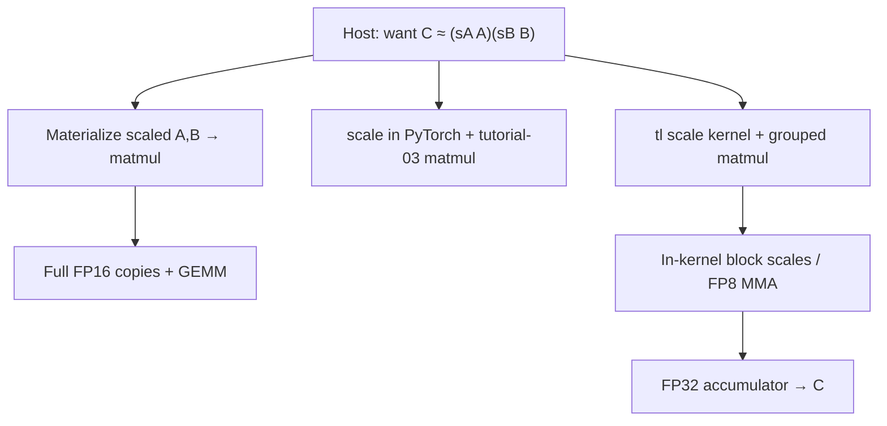
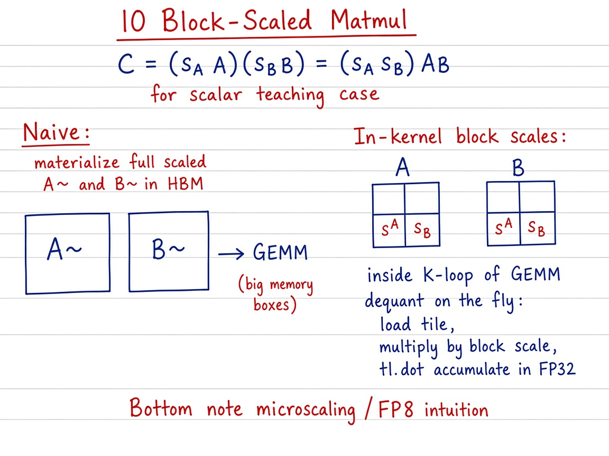

# Visual guide — Block-Scaled Matrix Multiplication

This note complements the [official Triton tutorial](https://triton-lang.org/main/getting-started/tutorials/10-block-scaled-matmul.html).

## Goal

Learn scaled GEMM as a ladder: materialize \(s_A A,s_B B\) → Triton scale + tutorial-03 GEMM → in-kernel per-block / FP8 scales fused into the \(K\)-loop.

## Mental model

## Visual: theory board (method / logic)
## Theory board

*Theory board — materialize scaled $A,B$ vs dequant with per-block scales inside the $K$-loop.*

*Theory board — materialize scaled $A,B$ vs dequant with per-block scales inside the $K$-loop.*

Scalar teaching kernels prove homogeneity; production FP8 / MX paths keep payloads narrow and apply \(s^{A},s^{B}\) next to each `tl.dot` panel — same tile grid as tutorial 03.

## Step-by-step (what each phase does)

1. **Naive** — \(\tilde A=s_A A\), \(\tilde B=s_B B\), \(C=\tilde A\tilde B\). Clear algebra; doubles working set for scalars and is worse for dense block-scale tables.
2. **Intermediate** — same scaling on host/device tensors; GEMM via tutorial-03 `matmul` ([`03_matrix_multiplication`](../../03_matrix_multiplication/README.md)).
3. **Triton sketch** — elementwise `y = x * s` kernel (stand-in for on-the-fly dequant), then grouped matmul.
4. **Block / FP8 (official)** — each \(K\)-panel loads low-precision tiles **and** their scales; MMA accumulates in FP32; store \(C\) in FP16/FP32.
5. **Correctness / error** — scalars: exact \((s_A s_B)AB\) up to rounding. Blocks: measure \(\|AB - A_q B_q\|_F/\|AB\|_F\).

## Tips

- Per-tensor scales fail on outliers; per-block scales buy dynamic range for little metadata.
- Keep the tutorial-03 tile/`tl.dot` mental model — scales are extra operands on the same panels.
- Hardware tensor cores may fuse scale application into the MMA pipeline; read device-specific notes in the official tutorial.
- Re-run `python scripts/download_tutorial_images.py` if figures are missing offline.

## See also

- [Tutorials index](https://triton-lang.org/main/getting-started/tutorials/index.html)
- Matmul primer: [`../../03_matrix_multiplication/README.md`](../../03_matrix_multiplication/README.md)
- Deep dive: [`README.md`](README.md)
- Repo notebook: `10_block_scaled_matmul.ipynb`
