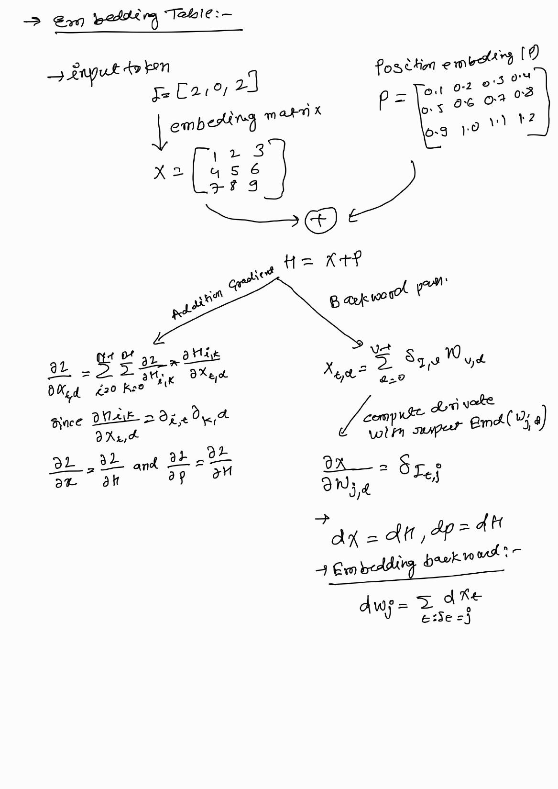
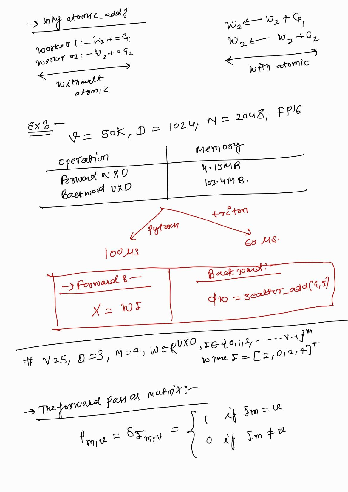
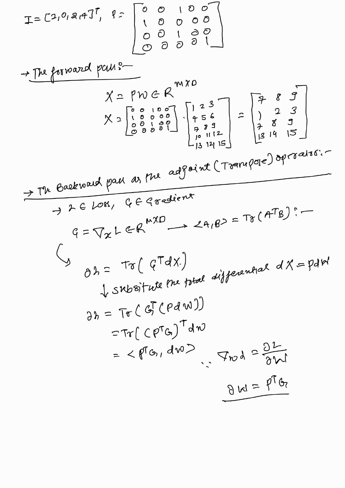
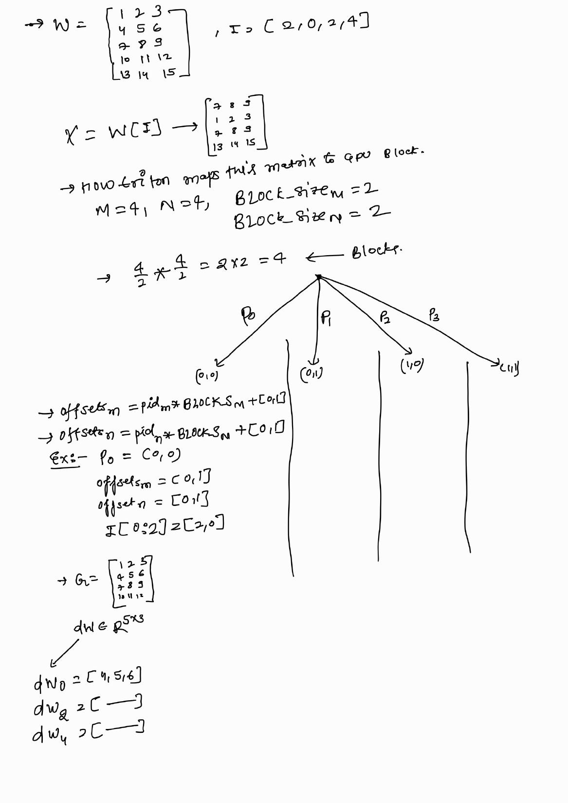

# 11 — Embedding Forward and Backward

> **Goal.** Implement an embedding table lookup $X=W[I]$ and its gradient
> $dW[I_m]\mathrel{+}=G_m$ as Triton kernels, and understand why the backward
> uses **atomic scatter-add**.

Source notes: [`doc/Embedding_kernal.pdf`](doc/Embedding_kernal.pdf) · Notebook:
[`11_embedding_forward_kernel.ipynb`](11_embedding_forward_kernel.ipynb) ·
Runnable script: [`tutorial.py`](tutorial.py) ·
Deep dive: [`docs/README.md`](docs/README.md) ·
Visual guide: [`docs/visual-guide.md`](docs/visual-guide.md)

---

## Study ladder

1. **Naive (Method 01)** — one-hot matrix product $X=PW$ and a Python loop that
   adds each gradient row into its token row.
2. **Kernel-based (Method 02)** — a 2-D tiled Triton **gather** for the forward
   and an `tl.atomic_add` **scatter-add** for the backward.
3. **Fused kernel-based (Method 03)** — one kernel computes
   $H=W[I]+\mathcal P$; the backward accumulates bf16 gradients in fp32.

**Study tip.** Write the index maps by hand for $V=5,D=3,M=4$ before reading
the kernels. The backward is the expensive phase because it touches the whole
$V\times D$ table, even when only a few rows are used.

---

## Mathematical definition

Let $W\in\mathbb R^{V\times D}$ be the table, $I_m\in\{0,\dots,V-1\}$ a token
id, and $M$ the number of tokens.

$$
X_{m,:}=W_{I_m,:},
\qquad
X=W[I].
$$

With the one-hot matrix $P_{m,j}=\mathbf 1[j=I_m]$,

$$
X=PW.
$$

For a position table $\mathcal P\in\mathbb R^{M\times D}$,

$$
H=X+\mathcal P,
\qquad
\frac{\partial L}{\partial X}=\frac{\partial L}{\partial H},
\qquad
\frac{\partial L}{\partial \mathcal P}=\frac{\partial L}{\partial H}.
$$

Given $G=\partial L/\partial X$,

$$
dW=P^\top G,
\qquad
dW_{j,:}=\sum_{m:\,I_m=j}G_{m,:}.
$$

The forward is a **gather**; the backward is a **scatter-add**.

---

## Worked example (from the notes)

$V=5$, $D=3$, $M=4$:

$$
W=\begin{bmatrix}1&2&3\\4&5&6\\7&8&9\\10&11&12\\13&14&15\end{bmatrix},
\quad
I=\begin{bmatrix}2\\0\\1\\2\end{bmatrix},
\quad
X=\begin{bmatrix}7&8&9\\1&2&3\\4&5&6\\7&8&9\end{bmatrix}.
$$

With $G=\begin{bmatrix}1&2&3\\4&5&6\\7&8&9\\10&11&12\end{bmatrix}$:

$$
dW_0=\begin{bmatrix}4&5&6\end{bmatrix},\quad
dW_1=\begin{bmatrix}7&8&9\end{bmatrix},\quad
dW_2=\begin{bmatrix}11&13&15\end{bmatrix},
$$

and rows $3,4$ are zero. Token $2$ appears twice, so its gradient is the sum
$G_0+G_3$ — the collision that forces atomics.

---

## Why atomics?

Two programs can own tokens with the **same** id. A plain store races and one
update is lost:

| Without atomic | With `tl.atomic_add` |
|---|---|
| worker 0: `W[2] = G_0` | worker 0: `W[2] += G_0` |
| worker 1: `W[2] = G_3` | worker 1: `W[2] += G_3` |
| result: `G_0` **or** `G_3` | result: `G_0 + G_3` |

The sum is correct, but floating-point addition order is not fixed, so repeated
runs may differ in the last bits. Use a deterministic segmented reduction if
you need bitwise reproducibility.

---

## Cost model

For $M$ tokens, width $D$, vocabulary $V$, and $b$ bytes per element:

| Phase | Traffic | Dominant term |
|---|---|---|
| Forward | read $MDb$ + write $MDb$ | $2MDb$ |
| Backward | touch table $VDb$ + read grad $MDb$ | $VDb$ |

For $V=50{,}000$, $D=1024$, $M=2048$, fp16 ($b=2$):

- forward output: $MDb=4.19$ MB (total forward traffic $2MDb=8.39$ MB);
- backward table: $VDb=102.4$ MB (total backward traffic $106.6$ MB);
- total backward / total forward ≈ $12.7\times$; the table alone is ≈ $24\times$
  the forward output.

This counts the zero-fill and the gradient reads; atomics on touched rows add a
little more. Production systems therefore use sparse gradients, row caches, or
fused optimizers.

---

## Visual: theory board



*Page 1 — table lookup, $H=X+\mathcal P$, the adjoint derivation, and the
embedding backward $dW_j=\sum_{i:I_i=j}dX_i$.*



*Page 2 — why atomics are needed, the $V=50k,D=1024,N=2048$ memory example,
and the forward/backward one-liners.*



*Page 3 — $X=PW$ and the adjoint derivation $dW=P^\top G$.*



*Page 4 — $M=4,D=4$, $B_M=B_N=2$ → four programs, and the row sums for $dW$.*

More figures (including the Method 01/02 code boards) are in
[`docs/visual-guide.md`](docs/visual-guide.md).

---

## Files

| File | Purpose |
|---|---|
| `11_embedding_forward_kernel.ipynb` | Lesson: math, worked example, kernels, tests |
| `tutorial.py` | Same code as a runnable script (`python tutorial.py`) |
| `docs/README.md` | Deeper proofs, atomics, bf16, sparse gradients, exercises |
| `docs/visual-guide.md` | Mental model and figure index |
| `docs/images/` | Whiteboard pages from the source PDF |
| `doc/Embedding_kernal.pdf` | Original handwritten notes |

---

## How to run

```bash
cd 11_embedding_forward_kernel
jupyter notebook 11_embedding_forward_kernel.ipynb
# or
python tutorial.py
```

CPU: the naive forward/backward and the worked example run; GPU tests print
`SKIP ...`. CUDA/ROCm: all correctness tests run.

---

## Pitfalls

- Missing row/column masks on the last tile → out-of-bounds accesses.
- `tl.store` instead of `tl.atomic_add` in the backward → lost gradients when ids repeat.
- Accumulating bf16 atomics directly → slow/unsupported; accumulate fp32.
- Assuming the gradient is sparse: `torch.zeros_like(table)` still writes $VD$ bytes.
- Negative ids (PyTorch wraps; `nn.Embedding` rejects) — define and check the contract.
- Broadcasting a shared position table without summing $dH$ over the broadcast axis.

## Self-check

1. Write $P$ for $I=[2,0,1,2]$ and verify $X=PW$ and $dW=P^\top G$.
2. Prove $dW_{j,:}=\sum_{m:I_m=j}G_{m,:}$.
3. Give two ids that collide and explain the race.
4. Recompute the forward/backward byte counts for fp32 and bf16.
5. Change `BLOCK_M`/`BLOCK_N` and confirm full coverage.
6. Extend the fused kernel to a shared `(1, D)` position table.
