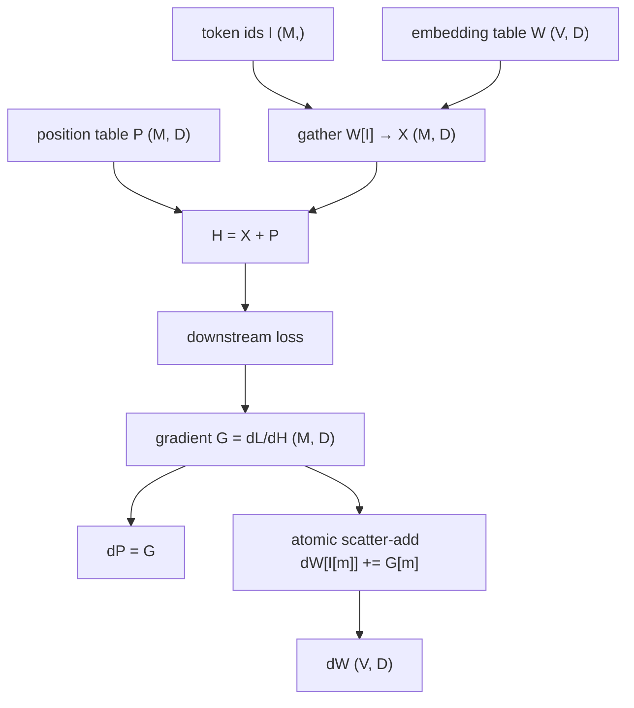
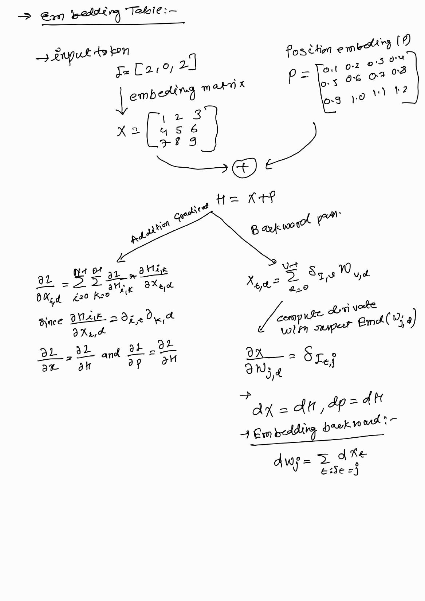
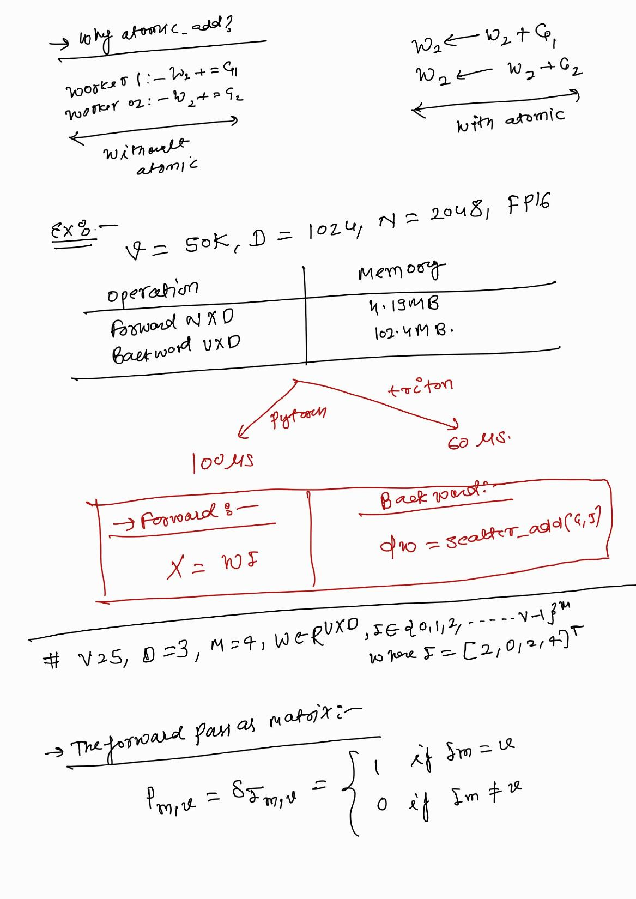
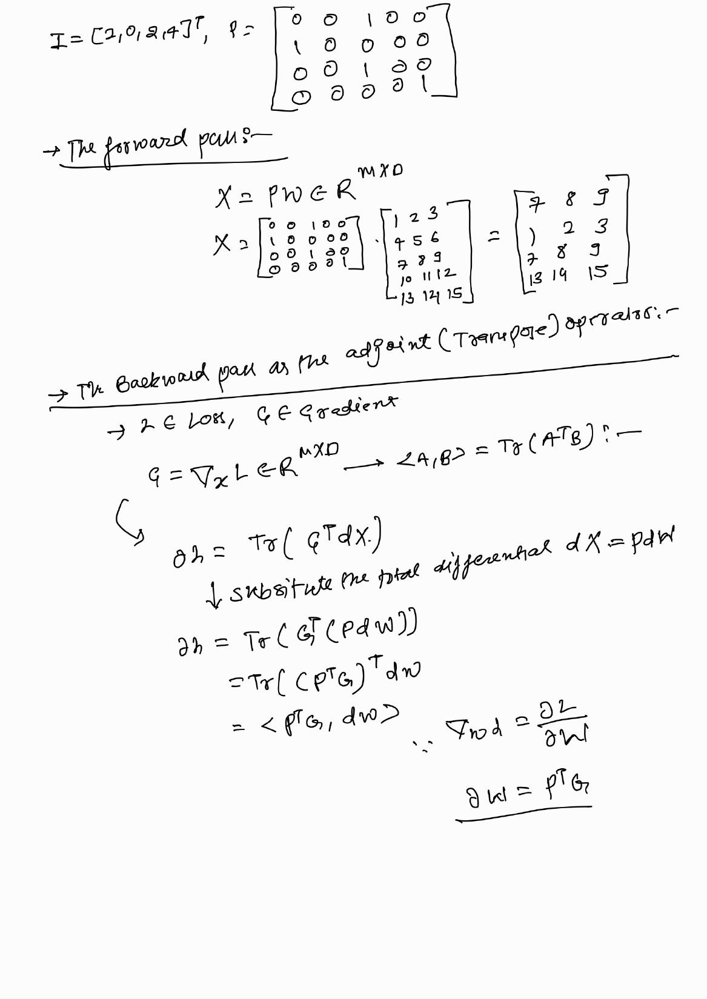
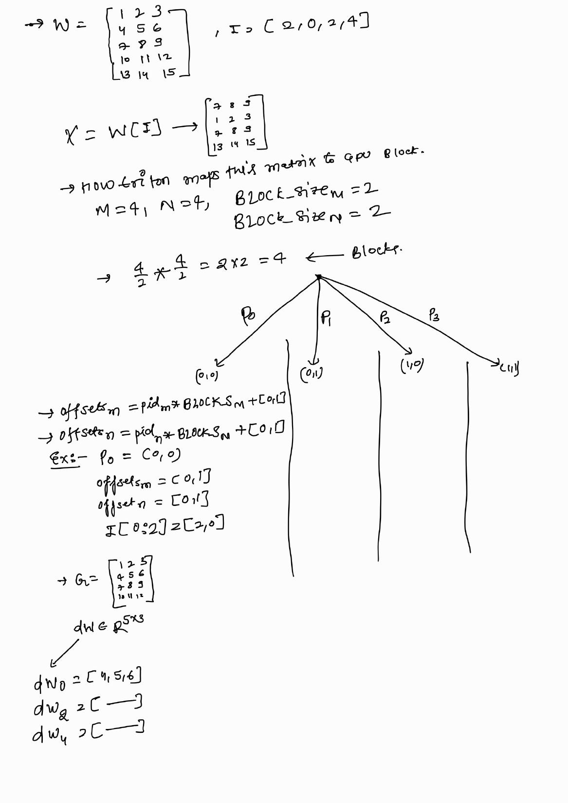
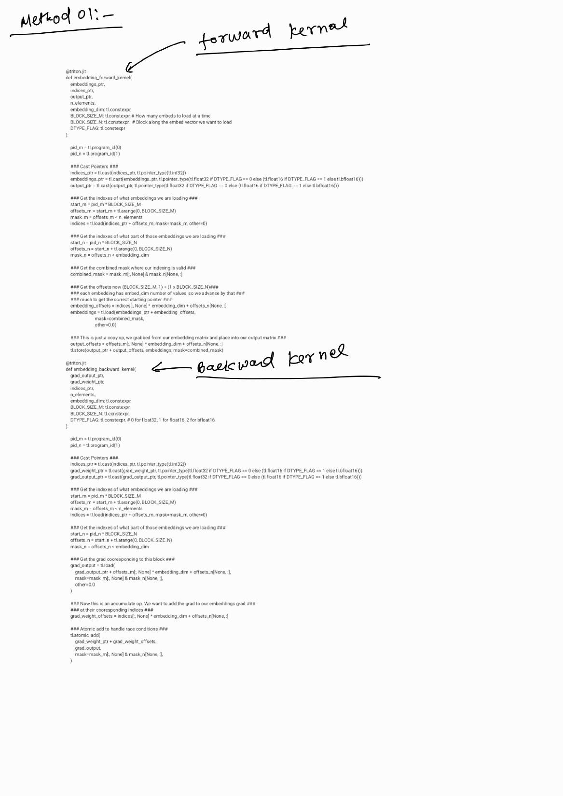
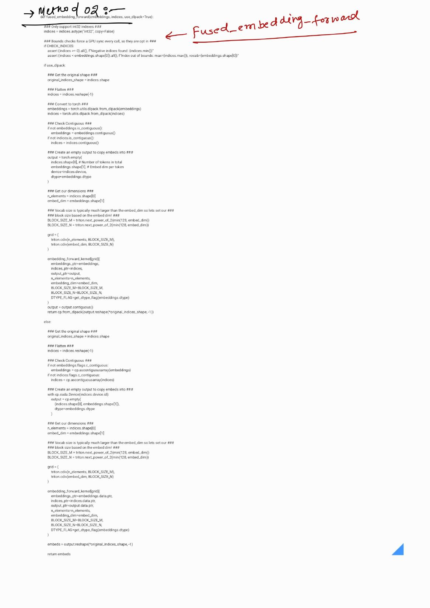
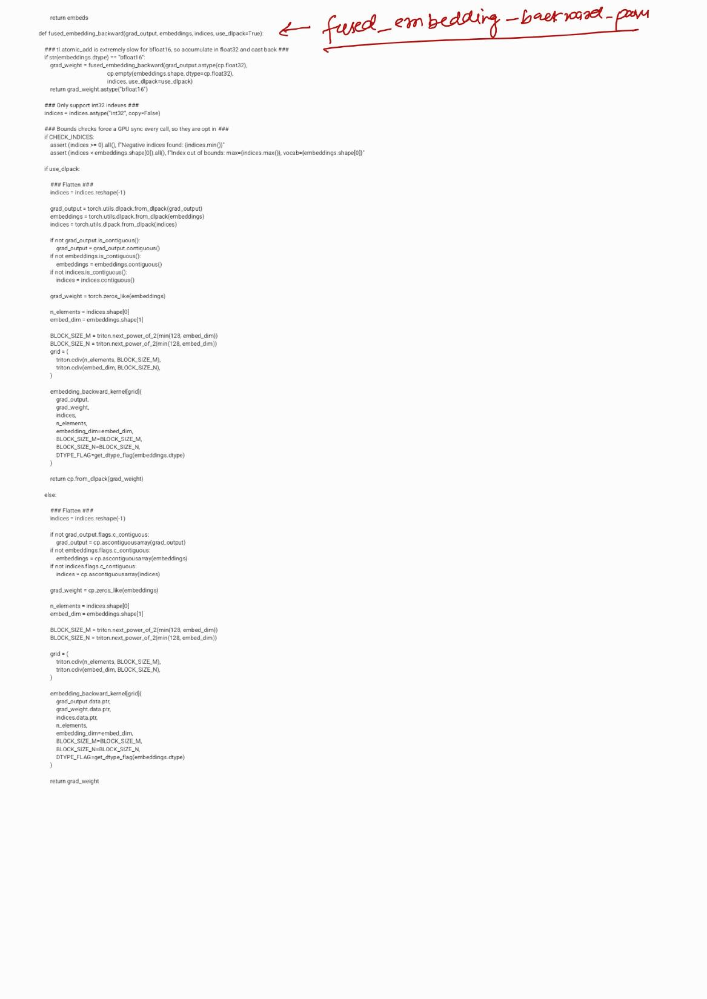

# Visual guide — Embedding Forward and Backward

Companion to [`README.md`](../README.md) and the notebook. The handwritten
boards in [`images/`](images/) are the source notes.

## Goal

Treat an embedding as **indexing**:

- forward: `X[m, :] = W[ids[m], :]` — a gather;
- backward: `dW[ids[m], :] += G[m, :]` — a scatter-add.

Then block the token and embedding axes for Triton and handle duplicate ids with
atomics.

## Mental model



The **gather** is read-only and embarrassingly parallel. The **scatter-add** is
the only place that needs synchronization: two tokens can point at the same row.

## Figures in this folder

| Figure | What it shows |
|--------|----------------|
|  | Table, position embedding, $H=X+\mathcal P$, forward/backward derivation |
|  | Why atomics; $V=50k,D=1024,N=2048$ memory; forward/backward one-liners |
|  | $X=PW$, adjoint derivation $dW=P^\top G$ |
|  | $M=4,D=4$, $B_M=B_N=2$ → four programs; $dW$ row sums |
|  | Method 01 forward/backward kernels (notes) |
|  | Method 02 fused forward wrapper (notes) |
|  | Method 02 backward wrapper, bf16 promotion (notes) |

## Step-by-step

1. **Write the index maps.** Forward $I_m\mapsto$ row $I_m$; backward
   $I_m\mapsto$ row $I_m$ with `+=`.
2. **Check the tiny case.** $V=5,D=3,M=4$, $I=[2,0,1,2]$: $X$ rows are
   $7,1,4,7$; $dW_2=G_0+G_3$.
3. **Choose tiles.** 2-D grid over tokens ($B_M$) and embedding width ($B_N$).
   Mask rows `< M`, cols `< D`.
4. **Forward kernel.** Load `ids`, form `ids[:, None] * D + cols[None, :]`,
   masked `tl.load`, masked `tl.store`.
5. **Backward kernel.** Load `G` tile, form the same offsets from `ids`, then
   `tl.atomic_add` into `dW`. Zero `dW` first.
6. **Pick dtypes.** fp32/fp16 direct; bf16 promote to fp32, then cast back.
7. **Fuse position add.** One load from the table + one from the position table
   + one store; no intermediate $X$.
8. **Test.** Compare with `table[ids]` and `index_add_`; include duplicate ids,
   odd sizes, non-contiguous tables, and fp16/bf16.

## Tile map (page 4)

For $M=4$, $D=4$, $B_M=B_N=2$:

```
        cols 0-1     cols 2-3
rows 0-1  pid (0,0)   pid (0,1)
rows 2-3  pid (1,0)   pid (1,1)
```

Each program owns a $2\times2$ tile. With $M=5$ or $D=7$ the last row/column of
tiles is partial, and the mask removes the extra lanes.

## Tips

- `ids` must be an integer tensor; the kernel casts to `int32` for compactness.
- Use `.contiguous()` on `table`, `ids`, and `grad_out` before launch.
- `check_indices=True` is convenient while debugging but costs a GPU sync.
- The backward output is dense: `dW` is always `(V, D)`, even if one token is used.
- If atomics are the bottleneck, sort by id and do a segmented reduction.

## See also

- [Triton language: `tl.atomic_add`](https://triton-lang.org/main/python-api/generated/triton.language.atomic_add.html)
- [PyTorch `nn.Embedding`](https://pytorch.org/docs/stable/generated/torch.nn.Embedding.html)
- [PyTorch `index_add_`](https://pytorch.org/docs/stable/generated/torch.Tensor.index_add_.html)
